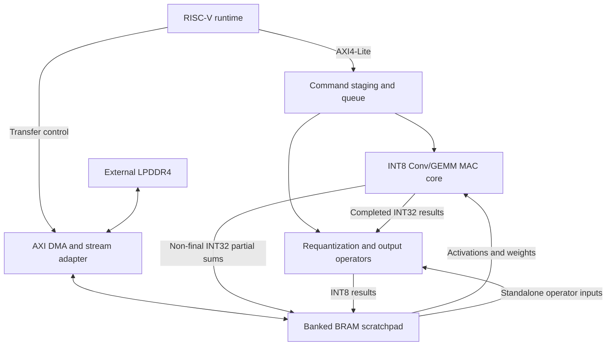
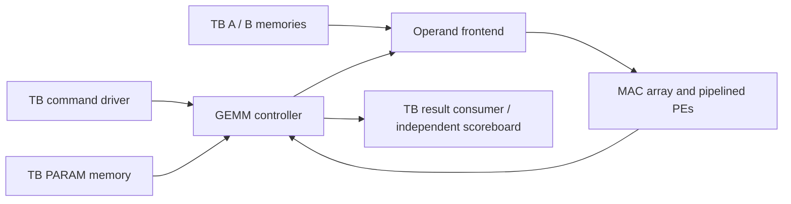

# RAVEN

**RISC-V-Controlled Programmable FPGA Neural Processing Unit**

RAVEN is a senior capstone project developing a programmable INT8 neural processing unit for the AMD/Avnet Ultra96-V2. A RISC-V soft processor will schedule neural-network operations on a shared compute engine, with DMA moving tensors between external LPDDR4 and on-chip BRAM.

The goal is to execute multiple supported model graphs using one FPGA bitstream and one runtime binary. Intended applications include audio anomaly detection, keyword spotting, and visual wake-word person detection, with inference performed locally on the board.

**Current status: standalone compute, activation-buffer and requantization/clamp RTL, with testbenches and golden-fixture tools.** The compute implementation performs one resident INT8 GEMM tile and returns signed INT32 results. Command driving, operand memories and the result consumer in its tests are stand-ins. The three RTL blocks are not yet connected into a full system. Full-system integration and FPGA measurements remain future work; the broader architecture below is a proposal.


## Documentation and ownership

| Area | Owner | Research document |
|---|---|---|
| Compute architecture, MAC datapath, pipeline, and compute verification | Michael | [NPU compute architecture](docs/NPU_ARCHITECTURE.md) |
| Requantization, activation, pooling, element-wise Add, and operator verification | Quan | [NPU operators and datapath support](docs/NPU_Operators_Research.md); [requantization implementation](rtl/operators/README.md) |
| BRAM organization, memory interfaces, DMA, and memory verification | Taylor | [Memory-system research](docs/RAVEN_Memory_System_Research.md); [memory buffers](rtl/memory/README.md) |
| RISC-V integration, MMIO, control, and runtime | Nahjay | [RISC-V integration and runtime](docs/RISCV_Research.md) |
| Model analysis/export, tensor extraction, and golden-reference generation | Jackie | [Quantized-model research](docs/Quantized_Models.md); [golden fixtures and GEMM verification](evidence/prealpha/compute/README.md) |

The research documents describe broader proposed behavior and identify implemented subsets. The [shared interface contract](docs/interfaces/RAVEN_INTERFACE_CONTRACT.md) defines the operand, DMA, mailbox, constant-format, and recovery baseline. The [project plan](docs/PROJECT_PLAN.md) holds shared acceptance goals and milestones. Full-system implementation, FPGA timing, and model-quality evidence remain to be collected; standalone simulation instructions are linked below.

Use [docs/RAVEN_Memory_System_Research.md](docs/RAVEN_Memory_System_Research.md)
for the current memory proposal and [the revised draft sections](docs/drafts/RAVEN_Design_Draft_Revised_Memory_DMA_Sections.md)
for memory/DMA draft wording. Other research copies and existing Word/PDF exports
are review snapshots; their interface and capacity descriptions may be superseded.

## Current subsystem status and integration

| Area | Implemented and tested | Connection still needed |
|---|---|---|
| Compute — Michael | Resident INT8 GEMM microtile, INT32 output, reset/backpressure/error tests | Production operand responders, command control and output storage |
| Memory — Taylor | 128-byte activation buffer, eight-lane reads, standalone bench | Adapter/frontend agreement, weight/parameter storage, DMA and bank ownership |
| Operators — Quan | One-lane INT32-to-INT8 requantization/clamp, tags and elastic output, standalone bench | Channel mapping, per-channel parameter delivery and destination storage |
| Goldens — Jackie | Reproducible fixtures, byte comparator and three extra INT32 GEMM cases | Connected memory-to-GEMM-to-INT8 tests against the independent outputs |

Compute's operand frontend requests 128-bit words with bank-local byte offsets
and gathers lanes internally. The activation buffer instead returns eight bytes
for a four-bit K selector. These interfaces need an agreed adapter or frontend
change. Its active-high asynchronous reset must be coordinated with compute's
synchronous active-low reset; responders must flush stale replies on restart.

The compute result lane supplies data, row, column, index and last. The operator
tail also needs a channel tag and that channel's multiplier, shift, output
zero-point and clamp range. Channel/base mapping and parameter delivery remain
integration work. Backpressure must propagate through the tail, and system
completion must follow final output acceptance/storage. No connected
memory → GEMM → INT8 → storage result is claimed by the standalone tests.

## Proposed system architecture



The proposed compute core is a parameterized output-stationary array. Dense Conv2D maps onto the GEMM datapath through a window frontend; firmware schedules bank-fitting tiles and K-dimension chunks. Partial sums remain INT32 until the reduction finishes, with bias applied once. The proposed final K-chunk path reads an explicitly identified partial-sum context and writes INT8 results to a separate destination bank.

The RISC-V runs the layer schedule, programs transfers, and executes software fallback kernels. The ARM Cortex-A53 is assigned board boot and file staging in the baseline. Depthwise hardware remains an open decision; fallback time and transfers must be included in end-to-end results.

### Control and memory interfaces

The current register and command proposal is in [RISC-V research §§6–7](docs/RISCV_Research.md). It replaces the original `PARAM_DIM` and `ADDR_IN`/`ADDR_WEIGHT`/`ADDR_OUT` sketch. NPU commands use scratchpad bank/offset references; DDR addresses belong to the DMA interface.

Three blocks have separate responsibilities:

- **NPU control:** staging registers, a proposed four-entry command queue, operation fields, completion/error status, and performance counters.
- **AMD AXI DMA:** vendor MM2S/S2MM registers for DDR-to-stream and stream-to-DDR transfers.
- **RAVEN stream adapter:** proposed fill/drain registers, scratchpad selection, byte counts, and bank ownership.

GEMM A stays row-major: two local 8×16-byte buffers turn sequential 128-bit row reads into eight activation lanes. The proposed Conv path adds a bounds-checked window gatherer; it is not part of the current compute RTL.

Input ping-pong banks allow filling a FREE bank while another is in use. A received DMA packet stays DMA_FILLING until firmware checks successful MM2S completion and explicitly commits the bank to READY. Exact byte lengths and final byte masks support short model tensors. Typed READY/FULL rules govern source consumption; retained tensors and unfinished partial sums cannot be overwritten. A drained output bank is released after successful DMA and adapter completion. See the [memory proposal](docs/RAVEN_Memory_System_Research.md) for capacity, bandwidth, and ownership details.

## Compute implementation and tests

The demonstrated use case is **8×16 signed INT8 activations × 16×8 signed INT8
weights + bias → 8×8 signed INT32 results**. The implementation includes the MAC
datapath/array, pipeline, operand frontend, controller and compute verification.

| Design file | What it does |
|---|---|
| [raven_mac_pe.sv](rtl/compute/raven_mac_pe.sv) | Saves a signed INT8 product, adds it to an INT32 seeded sum, handles valid bubbles and detects signed overflow |
| [raven_mac_array.sv](rtl/compute/raven_mac_array.sv) | Connects the PEs into an output-stationary array with row/column broadcasts and masks |
| [raven_gemm_frontend.sv](rtl/compute/raven_gemm_frontend.sv) | Reads row-major A and packed B, buffers their words and pairs operands at the same K position |
| [raven_gemm_core.sv](rtl/compute/raven_gemm_core.sv) | Checks and saves a command, reads corrected bias, sequences the reduction and drains tagged INT32 outputs |



The design top is `raven_gemm_core`. Default ROWS=COLS=8; each physical dimension
supports 1..8. A command is accepted on `cmd_valid_i && cmd_ready_o` and saves M,
N, K, A row pitch and A/B/PARAM starting offsets. M and N must fit the physical
array. There is one command in flight and one complete resident K reduction.

Three separate 128-bit memory request/response interfaces use valid/ready,
16-byte-aligned bank-local byte offsets (24 bits by default) and one outstanding
request per port. Hold a request address stable until it is accepted. The
responder must hold response valid/data until response-ready is asserted;
an early response cannot be a one-clock pulse that disappears before acceptance.
Transfers occur on a rising clock edge with both valid and ready high.
Responses are ordered, with no transaction IDs or memory-error sideband.
Default ACT/WGT/PARAM capacities are 16 KiB / 16 KiB / 4 KiB. A rows have a
16-byte-aligned pitch at least round_up(K,16). B always has eight physical
column lanes per K position. Each PARAM channel record is 16 bytes; compute
reads its signed corrected bias from bytes 0..3. All rounded physical reads
must fit their selected bank. Logical K padding is not accumulated.

The output is one signed INT32 valid/ready lane with row, column, logical
index `row*N+column` and last marker. Data and tags stay fixed during a stall.
Corrected bias is applied once:
`original_bias[j] - input_zero_point * sum(B[k,j])`. The Python reference
independently computes `original_bias[j] + sum((A[i,k]-input_zero_point)*B[k,j])`
with wide integers.

### Run the compute tests

Requires Python 3.9+ and a working Questa installation/license. Add your
simulator's executable directory to PATH, set QUESTA_BIN locally, or use
`--questa-bin "<your-questa-bin-directory>"`. No script assumes a personal
checkout or installation path. TensorFlow, NumPy, Make and a C++ toolchain are
not needed for these synthetic Questa tests.

```sh
python tests/rtl/compute/run_questa.py
python tests/rtl/compute/run_questa.py --demo-only
```

The runner finds the checkout from its own location. Generated fixtures,
libraries, transcripts and waveforms go into a fresh directory under
`build/tests/compute/questa/`; `latest.json` points to the report using a path
relative to its directory. A relative `--build` override is resolved from the
caller's working directory.

For the GUI, change to the generated run directory printed by the runner and
enter `do view_demo.do`. The demo prints the checked matrix and captures VCD/WLF
waveforms. The two testbenches and `sim_read_memory.sv` are under
`tests/rtl/compute/`; `generate_vectors.py` creates the independent fixtures,
and `run_questa.py` / `run_batch.do` enforce the run and failure checks.

Validation used **Questa Intel Starter FPGA Edition-64 2021.2**
with immediate and concurrent assertions enabled. The PE passed 65,536 signed
operand products plus seeded bubbles, both overflow directions, sticky overflow,
reinitialization and in-flight reset checks.
Each of 8×8, 4×4, 2×4 and 1×1 passed 42 fixtures and three reset/restart phases:
**168 fixtures and 12 reset/restart scenarios total**. The short demo checked
all 64 outputs. Separate intentional-failure checks confirmed assertion
execution and rejection of incomplete fixture manifests.

See the [combined execution log](evidence/questa/verification.log),
[source-hash/result report](evidence/questa/results.json),
[waveform preview](evidence/questa/demo_waveform.svg) and
[experiments, failures and difficulties](evidence/questa/experiments/README.md).
The experiment record links the actual failed attempts and their fixes.

### Known bugs, limitations and integration boundaries

No failing case remains in the executed supported suite. The testbench's
Questa declaration-initialization, fixture-name and incomplete-manifest issues
were fixed and are documented in the experiment record. The suite is not an
exhaustive proof of every possible sequence.

- One physical microtile per command, full resident K only and one result lane.
  Conv gathering, larger-tile traversal, saved-PSUM/K-chunk continuation,
  transpose/BLAS modes and four-lane output remain future work.
- The arithmetic uses raw signed INT8 operands, symmetric weights and corrected
  INT32 seeds. Any intermediate signed INT32 overflow rejects the tile after its
  reduction, without successful result beats. Export must validate seed/range
  compatibility. Codes: 0x00 success, 0x02 dimension/pitch, 0x03 alignment/span,
  0x08 accumulation overflow.
- Reset is synchronous active-low. Compute and memory responders must reset/flush
  together. Stale replies after an independent reset are unsupported.
- The core has no autonomous timeout/abort recovery. Missing memory responses or
  a permanently blocked consumer can stall it indefinitely. Simulation watchdogs
  do not implement an on-chip supervisor.
- `compute_done` follows the last product's commitment, including a reduction
  rejected for overflow. `result_done` follows INT32 acceptance or rejection.
  System retirement still requires actual downstream storage and successful
  bank transitions.
- The command driver, memory responders and scoreboard are simulation stand-ins.
  Teammates retain production responsibility for RISC-V/CSR, physical BRAM/DMA,
  requantization/INT8 storage and model export.
- No synthesis, DSP inference/resource measurement, routed timing, board test or
  full-model inference is claimed. The 10 ns simulation clock is stimulus.

## Initial design targets

| Parameter | Proposed target |
|---|---|
| FPGA platform | Ultra96-V2, Zynq UltraScale+ MPSoC ZU3EG |
| Control processor | RISC-V soft processor; MicroBlaze V proposed, pending integration review |
| Initial compute array | 8×8, or 64 scalar MACs; larger configurations evaluated later |
| Numerical formats | Signed INT8 activations/weights; architectural INT32 accumulation with validated ranges |
| Clock and timing | At least 100 MHz; non-negative routed timing slack |
| Result interface | One lane for functional bring-up; four lanes as an evaluation configuration; target II=1 |
| Control interface | 32-bit MMIO over AXI4-Lite |
| DMA path | Proposed 128-bit memory-mapped and stream paths at nominal 100 MHz, subject to connectivity and timing |
| Base logical scratchpad allocation | 74–88 KiB |
| Additional parameter/output storage | +4 KiB PRM; optional +8–16 KiB OUT1; total 86–108 KiB with both |
| FPGA resource use | Original planning target below approximately 80%; verify each resource in synthesis/implementation |
| Operator/model goals | Six NPU operators and three selected models, subject to team acceptance decisions |

At 100 MHz and full occupancy, 64 MACs yield a theoretical ceiling of **6.4 GMAC/s**, or **12.8 GOPS** when multiplication and addition count separately. A 128-bit interface at that clock has an ideal payload ceiling of **1.6 GB/s per direction**. Neither figure establishes achieved performance. Utilization, pipeline/drain overhead, local-memory ports, DMA, and fallback work all affect results.

Scratchpad figures are logical allocations, not measured physical BRAM use; the parameter bank and OUT1 are additions to the base budget. See [compute estimates](docs/NPU_ARCHITECTURE.md) and [memory estimates](docs/RAVEN_Memory_System_Research.md) for assumptions.

## Proposed operator set

| Opcode | Operation | Planned role |
|---|---|---|
| `0x01` | Conv2D | Dense and pointwise convolution using the shared compute core |
| `0x02` | GEMM | Matrix multiplication and fully connected layers |
| `0x03` | ReLU | Standalone activation; also fused after final requantization |
| `0x04` | Pooling | Average pool first; max pool as an extension |
| `0x05` | Requantization | INT32-to-INT8 scaling/clamping, standalone or fused after a completed reduction |
| `0x06` | Element-wise Add (EWADD) | Quantized residual addition with input/output rescaling |
| `0x07` | Depthwise Conv | Reserved; hardware mapping undecided, initial RISC-V fallback |

The six-operator goal covers `0x01`–`0x06`; the reserved depthwise opcode does not count as implemented support. Pooling and EWADD follow the initial FC/Conv bring-up. Softmax and metadata operations such as reshape belong to the runtime plan.

Exact arithmetic and field definitions are in the [operator proposal](docs/NPU_Operators_Research.md) and [control proposal](docs/RISCV_Research.md), including the proposed pinned TFLM integer reference, EWADD pre-shift, and widened POOL stride fields.

## Candidate models

| Model | Application | Proposed use |
|---|---|---|
| Deep Autoencoder (AD01) | Audio anomaly detection | First integration candidate: fully connected layers, requantization, and fused ReLU |
| DS-CNN | Keyword spotting | Candidate after AD01; requires depthwise execution and average pooling |
| MobileNetV1 0.25x | Visual wake-word person detection | Third candidate; depthwise fallback and feature-map tiling need measurement |
| ResNet-8 | Image classification | Alternative/extension requiring residual Add |
| Streaming DS-CNN | Streaming wake-word detection | Alternative/extension requiring depthwise execution |

Model files are present under [models/](models/). The [model inventory](docs/Quantized_Models.md) records source provenance, tensor shapes, operator counts, quantization, and parameter storage. The proposed first three are AD01, DS-CNN, and MobileNetV1; their inclusion here does not indicate working FPGA inference.

## Planned deployment and verification

The deployment toolchain will inspect supported graphs, retain original CPU/reference weights and bias, add separately referenced packed NPU weights/corrected-bias records, prepare integer quantization parameters, plan storage/tiling, and generate golden tensors. Tensor scale bits are preserved separately from execution multipliers. The runtime proposal starts with generated C layer tables and progresses to a validated data-driven model blob, allowing model changes without rebuilding the runtime.

Proposed driver entry points include `raven_dma_transfer()`, `raven_set_op()`, and `raven_start()`; these APIs are documented plans, not available code in this checkout.

Verification will compare integer outputs against the agreed reference at PE, tile, operator, layer, and model levels. Tests must cover edge tiles, K-chunk continuation, bias applied once, zero-points, rounding/clamping, backpressure, bank ownership, DMA integrity, and error recovery. Proposed numerical, model-quality and latency targets are in the [shared acceptance table](docs/PROJECT_PLAN.md#functional-and-model-acceptance); they still require measurement against pinned evaluation pipelines.

Benchmarks will report inference latency, useful MAC activity, input/output stalls, transfer bandwidth, FPGA resources, timing, and power where measured. Reports must include CPU fallback and data movement, and distinguish analytical ceilings from measured results.

## Development roadmap

| Phase | Intended outcome |
|---|---|
| Architecture and requirements | Review subsystem contracts, core/tool choices, operator scope, model candidates, and acceptance criteria |
| Independent subsystem development | Implement and verify compute, output operators, memory/DMA, control/runtime, and model tooling |
| First integration | Run synthetic GEMM/Conv workloads across the integrated control, compute, and memory paths |
| Real-model execution | Bring up AD01, then evaluate additional models and fallback costs against golden references |
| Beta | Demonstrate the agreed core features and selected models; collect baseline measurements |
| Optimization and handoff | Improve bottlenecks, complete verification, document limits, and test reproducible setup |

Use the [project milestones and acceptance table](docs/PROJECT_PLAN.md) for shared planning and acceptance criteria.

## Planned deliverables and limitations

Planned deliverables are an Ultra96-V2 prototype, SystemVerilog RTL, RISC-V firmware/drivers, model deployment tools, verification assets, benchmark reports, and architecture/interface/build documentation. The handoff proposal includes a tagged release, tested dependency versions, known-input examples, troubleshooting notes, and reproduction by someone other than the author.

FPGA resources, memory ports/bandwidth, timing closure, unsupported operators, quantization behavior, and integration complexity constrain the design. RISC-V fallbacks prioritize correctness and can dominate latency. Final model support, accuracy, throughput, power, and maintainability must be demonstrated through implementation and documented acceptance checks.

## Repository structure

```text
raven/
├── .github/            # Future CI workflow definitions
├── configs/            # Future design, model-export, and simulation presets
├── data/               # Local raw/processed datasets; contents ignored by Git
├── docs/               # Research, decisions, interface contracts, diagrams, and guides
├── evidence/           # Simulation results, verification notes and screenshots
├── rtl/                # Standalone compute, activation buffer and INT8 tail; future integration
├── hw/                 # Future Vivado Tcl, constraints, and IP configuration
├── software/           # Future firmware, runtime, drivers, HAL, and host tests
├── tools/              # Golden-fixture tools; future model export and register generation
├── tests/              # Standalone RTL tests and goldens; future integrated tests
├── benchmarks/         # Future workload definitions and measured result summaries
├── models/             # Five original candidate quantized TFLite models
├── third_party/        # Future explicitly vendored upstream dependencies
├── .gitignore
└── README.md
```

See the [full directory map and ownership guide](docs/REPOSITORY_STRUCTURE.md) for where each teammate's work belongs. Area READMEs describe current implementations and planned work; [automation notes](.github/AUTOMATION.md) cover future CI. `.gitkeep` files retain empty implementation folders in Git. Control, runtime, physical memory/DMA and full-system integration remain future work.

Generated products belong under the Git-ignored `build/` directory. See the compute run instructions in this README; additional build instructions will accompany their corresponding implementations.
