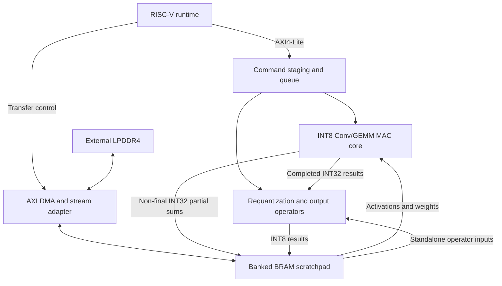

# RAVEN

**RISC-V-Controlled Programmable FPGA Neural Processing Unit**

RAVEN is a senior capstone project developing a programmable INT8 neural processing unit for the AMD/Avnet Ultra96-V2. A RISC-V soft processor will schedule neural-network operations on a shared compute engine, with DMA moving tensors between external LPDDR4 and on-chip BRAM.

The goal is to execute multiple supported model graphs using one FPGA bitstream and one runtime binary. Intended applications include audio anomaly detection, keyword spotting, and visual wake-word person detection, with inference performed locally on the board.

**Current status: architecture research and design proposals.** This repository currently contains five subsystem research documents, five candidate `.tflite` models, and a directory skeleton for future implementation. RTL, firmware, deployment tools, build scripts, and an FPGA demonstration are planned deliverables. No measured RAVEN throughput, timing closure, power, or inference accuracy is reported yet. Shared interface and configuration choices require team review and implementation verification.

## Documentation and ownership

| Area | Owner | Research document |
|---|---|---|
| Compute architecture, MAC datapath, pipeline, and compute verification | Michael | [NPU compute architecture](docs/NPU_ARCHITECTURE.md) |
| Requantization, activation, pooling, element-wise Add, and operator verification | Quan | [NPU operators and datapath support](docs/NPU_Operators_Research.md) |
| BRAM organization, memory interfaces, DMA, and memory verification | Taylor | [Memory-system research](docs/RAVEN_Memory_System_Research.md) |
| RISC-V integration, MMIO, control, and runtime | Nahjay | [RISC-V integration and runtime](docs/RISCV_Research.md) |
| Model analysis/export, tensor extraction, and golden-reference generation | Jackie | [Quantized-model research](docs/Quantized_Models.md) |

The documents describe proposed behavior. Their interface sign-offs and open decisions remain part of the design process.

## Proposed system architecture



The proposed compute core is a parameterized output-stationary array. Dense Conv2D maps onto the GEMM datapath through a window frontend; firmware schedules bank-fitting tiles and K-dimension chunks. Partial sums remain INT32 until the reduction finishes, with bias applied once. The proposed final K-chunk path reads an explicitly identified partial-sum context and writes INT8 results to a separate destination bank.

The RISC-V runs the layer schedule, programs transfers, and executes software fallback kernels. The ARM Cortex-A53 is assigned board boot and file staging in the baseline. Depthwise hardware remains an open decision; fallback time and transfers must be included in end-to-end results.

### Control and memory interfaces

The current register and command proposal is in [RISC-V research §§6–7](docs/RISCV_Research.md). It replaces the original `PARAM_DIM` and `ADDR_IN`/`ADDR_WEIGHT`/`ADDR_OUT` sketch. NPU commands use scratchpad bank/offset references; DDR addresses belong to the DMA interface.

Three blocks have separate responsibilities:

- **NPU control:** staging registers, a proposed four-entry command queue, operation fields, completion/error status, and performance counters.
- **AMD AXI DMA:** vendor MM2S/S2MM registers for DDR-to-stream and stream-to-DDR transfers.
- **RAVEN stream adapter:** proposed fill/drain registers, scratchpad selection, byte counts, and bank ownership.

Input ping-pong banks allow filling a FREE bank while another is in use. Typed READY/FULL rules govern source consumption; retained tensors and unfinished partial sums cannot be overwritten. A drained output bank is released after successful DMA and adapter completion. See the [memory proposal](docs/RAVEN_Memory_System_Research.md) for capacity, bandwidth, and ownership details.

## Initial design targets

| Parameter | Proposed target |
|---|---|
| FPGA platform | Ultra96-V2, Zynq UltraScale+ MPSoC ZU3EG |
| Control processor | RISC-V soft processor; MicroBlaze V proposed, pending integration review |
| Initial compute array | 8×8, or 64 scalar MACs; larger configurations evaluated later |
| Numerical formats | Signed INT8 activations/weights; architectural INT32 accumulation with validated ranges |
| Clock and timing | At least 100 MHz; non-negative routed timing slack |
| Result interface | One lane for functional bring-up; four lanes as an evaluation configuration; target II=1 |
| Control interface | 32-bit MMIO over AXI4-Lite |
| DMA path | Proposed 128-bit memory-mapped and stream paths at nominal 100 MHz, subject to connectivity and timing |
| Base logical scratchpad allocation | 74–88 KiB |
| Additional parameter/output storage | +4 KiB PRM; optional +8–16 KiB OUT1; total 86–108 KiB with both |
| FPGA resource use | Original planning target below approximately 80%; verify each resource in synthesis/implementation |
| Operator/model goals | Six NPU operators and three selected models, subject to team acceptance decisions |

At 100 MHz and full occupancy, 64 MACs yield a theoretical ceiling of **6.4 GMAC/s**, or **12.8 GOPS** when multiplication and addition count separately. A 128-bit interface at that clock has an ideal payload ceiling of **1.6 GB/s per direction**. Neither figure establishes achieved performance. Utilization, pipeline/drain overhead, local-memory ports, DMA, and fallback work all affect results.

Scratchpad figures are logical allocations, not measured physical BRAM use; the parameter bank and OUT1 are additions to the base budget. See [compute estimates](docs/NPU_ARCHITECTURE.md) and [memory estimates](docs/RAVEN_Memory_System_Research.md) for assumptions.

## Proposed operator set

| Opcode | Operation | Planned role |
|---|---|---|
| `0x01` | Conv2D | Dense and pointwise convolution using the shared compute core |
| `0x02` | GEMM | Matrix multiplication and fully connected layers |
| `0x03` | ReLU | Standalone activation; also fused after final requantization |
| `0x04` | Pooling | Average pool first; max pool as an extension |
| `0x05` | Requantization | INT32-to-INT8 scaling/clamping, standalone or fused after a completed reduction |
| `0x06` | Element-wise Add (EWADD) | Quantized residual addition with input/output rescaling |
| `0x07` | Depthwise Conv | Reserved; hardware mapping undecided, initial RISC-V fallback |

The six-operator goal covers `0x01`–`0x06`; the reserved depthwise opcode does not count as implemented support. Pooling and EWADD follow the initial FC/Conv bring-up. Softmax and metadata operations such as reshape belong to the runtime plan.

Exact arithmetic and field definitions are in the [operator proposal](docs/NPU_Operators_Research.md) and [control proposal](docs/RISCV_Research.md), including the proposed pinned TFLM integer reference, EWADD pre-shift, and widened POOL stride fields.

## Candidate models

| Model | Application | Proposed use |
|---|---|---|
| Deep Autoencoder (AD01) | Audio anomaly detection | First integration candidate: fully connected layers, requantization, and fused ReLU |
| DS-CNN | Keyword spotting | Candidate after AD01; requires depthwise execution and average pooling |
| MobileNetV1 0.25x | Visual wake-word person detection | Third candidate; depthwise fallback and feature-map tiling need measurement |
| ResNet-8 | Image classification | Alternative/extension requiring residual Add |
| Streaming DS-CNN | Streaming wake-word detection | Alternative/extension requiring depthwise execution |

Model files are present under [models/](models/). The [model inventory](docs/Quantized_Models.md) records source provenance, tensor shapes, operator counts, quantization, and parameter storage. The proposed first three are AD01, DS-CNN, and MobileNetV1; their inclusion here does not indicate working FPGA inference.

## Planned deployment and verification

The deployment toolchain will inspect supported model graphs, extract and pack weights, prepare corrected bias and quantization records, plan tensor storage/tiling, and generate golden tensors. The runtime proposal starts with generated C layer tables and progresses to a validated data-driven model blob, allowing model changes without rebuilding the runtime.

Proposed driver entry points include `raven_dma_transfer()`, `raven_set_op()`, and `raven_start()`; these APIs are documented plans, not available code in this checkout.

Verification will compare integer outputs against the agreed reference at PE, tile, operator, layer, and model levels. Tests must cover edge tiles, K-chunk continuation, bias applied once, zero-points, rounding/clamping, backpressure, bank ownership, DMA integrity, and error recovery. Model-level accuracy or task-quality thresholds remain team decisions.

Benchmarks will report inference latency, useful MAC activity, input/output stalls, transfer bandwidth, FPGA resources, timing, and power where measured. Reports must include CPU fallback and data movement, and distinguish analytical ceilings from measured results.

## Development roadmap

| Phase | Intended outcome |
|---|---|
| Architecture and requirements | Review subsystem contracts, core/tool choices, operator scope, model candidates, and acceptance criteria |
| Independent subsystem development | Implement and verify compute, output operators, memory/DMA, control/runtime, and model tooling |
| First integration | Run synthetic GEMM/Conv workloads across the integrated control, compute, and memory paths |
| Real-model execution | Bring up AD01, then evaluate additional models and fallback costs against golden references |
| Beta | Demonstrate the agreed core features and selected models; collect baseline measurements |
| Optimization and handoff | Improve bottlenecks, complete verification, document limits, and test reproducible setup |

The [control research §§18–21](docs/RISCV_Research.md) contains proposed calendar dates, dependencies, and sign-offs. Those subsystem dates require team adoption before serving as the project-wide schedule.

## Planned deliverables and limitations

Planned deliverables are an Ultra96-V2 prototype, SystemVerilog RTL, RISC-V firmware/drivers, model deployment tools, verification assets, benchmark reports, and architecture/interface/build documentation. The handoff proposal includes a tagged release, tested dependency versions, known-input examples, troubleshooting notes, and reproduction by someone other than the author.

FPGA resources, memory ports/bandwidth, timing closure, unsupported operators, quantization behavior, and integration complexity constrain the design. RISC-V fallbacks prioritize correctness and can dominate latency. Final model support, accuracy, throughput, power, and maintainability must be demonstrated through implementation and documented acceptance checks.

## Repository structure

```text
raven/
├── .github/            # Future CI workflow definitions
├── configs/            # Future design, model-export, and simulation presets
├── data/               # Local raw/processed datasets; contents ignored by Git
├── docs/               # Research, decisions, interface contracts, diagrams, and guides
├── rtl/                # Future compute, operators, memory, control, and integration RTL
├── hw/                 # Future Vivado Tcl, constraints, and IP configuration
├── software/           # Future firmware, runtime, drivers, HAL, and host tests
├── tools/              # Future model-export and register-generation tools
├── tests/              # Future RTL/integration tests, vectors, and register traces
├── benchmarks/         # Future workload definitions and measured result summaries
├── models/             # Five original candidate quantized TFLite models
├── third_party/        # Future explicitly vendored upstream dependencies
├── .gitignore
└── README.md
```

See the [full directory map and ownership guide](docs/REPOSITORY_STRUCTURE.md) for where each teammate's work belongs. Area READMEs describe the intended contents; [automation notes](.github/AUTOMATION.md) cover future CI. `.gitkeep` files retain empty implementation folders in Git. Source and test code will be added as development proceeds.

Generated products belong under the Git-ignored `build/` directory. Build and execution instructions will be added with the corresponding implementation and tested tool configuration.
