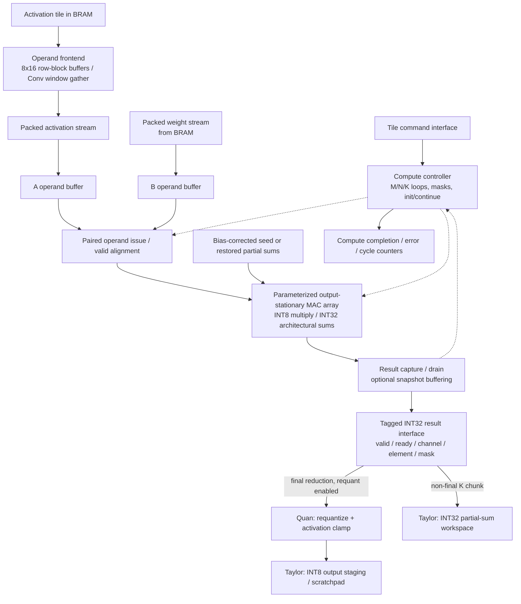

# RAVEN NPU Compute Architecture

**Status:** Initial research and proposed architecture; RTL implementation has not started.

**Owner:** Michael — NPU compute architecture and RTL.

**Target:** AMD/Avnet Ultra96-V2.

This document covers the compute core: MAC organization, dataflow, numeric formats, pipeline, tiling, and Conv/GEMM mapping. Memory delivery and output operators appear as interfaces that the compute core must agree on with the other subsystem owners. Proposed dimensions and interfaces remain subject to model analysis, simulation, and synthesis.

Shared interface proposals are documented in [Nahjay's control/runtime research](RISCV_Research.md) (§§6–9) and [Taylor's memory-system research](RAVEN_Memory_System_Research.md) (§§5–7). This document records the compute-side requirements; shared choices remain proposed until the subsystem owners agree and verify them.

Workload priorities below follow [Jackie's model inventory](Quantized_Models.md); result processing follows [Quan's operator proposal](NPU_Operators_Research.md). Model descriptions are reported research, not independent model verification or measured RAVEN support.

**Shared baseline (2026-10-23):** use the [interface contract](interfaces/RAVEN_INTERFACE_CONTRACT.md) for operand delivery, DMA commit, capabilities, CPU/NPU constants, and recovery; use the [project plan](PROJECT_PLAN.md) for dates and acceptance targets. These remain design specifications pending implementation evidence.

## 1. Initial proposal

Build a parameterized **output-stationary MAC array** with signed INT8 operands and architectural INT32 accumulation. Evaluate a small broadcast interconnect first, with a systolic implementation as an alternative if routing or timing favors it.

| Item | Proposed starting point | Status |
|---|---|---|
| Initial array | 8×8, or 64 scalar MACs | Bring-up configuration |
| Larger configuration | 8×16 or 16×8, or 128 scalar MACs | Evaluate after the baseline works |
| Dataflow | Output-stationary | Initial recommendation |
| Operand formats | Signed INT8 activations and weights | Initial compatibility profile |
| Raw product | Signed 16-bit | Required for INT8×INT8 |
| Accumulator/result | Signed INT32, with validated ranges | Initial architectural contract |
| Arithmetic rate | One MAC per PE per cycle after pipeline fill | Design target |
| Clock | At least 100 MHz | Design target; not achieved |
| Primary operations | GEMM and dense Conv2D on the same arithmetic core | Initial compute scope |
| Optional extension | Vector dot-product mode using the same multipliers | Investigate after baseline validation |

Choose the final array using actual layer shapes, routed timing, resource use, and operand/output throughput. The initial 8×8 size is a practical starting point, not a permanent performance ceiling.

### Candidate workloads and compute implications

| Reported candidate | Compute implication | Proposed role |
|---|---|---|
| AD01 deep autoencoder | Fully connected GEMMs plus requantization/fused ReLU; batch-one execution uses only one array row | First functional integration; not evidence of full-array throughput |
| DS-CNN keyword spotting | Dense/pointwise Conv and FC use this core; depthwise Conv needs a separate mapping or CPU fallback; average pool is an output-operator dependency | Candidate after AD01 |
| MobileNetV1 visual wake words | Dense/pointwise Conv plus depthwise, average pool, and runtime operations; feature maps require tiling | Candidate after AD01; profile fallback and memory costs |
| ResNet-8 / Streaming DS-CNN | ResNet adds residual EWADD; Streaming DS-CNN adds another depthwise workload | Alternatives/extensions, pending team model selection |

The recommended first three are candidates, not frozen acceptance requirements. Softmax, preprocessing, and application-level scoring belong to the runtime/model workflow. End-to-end latency must include CPU fallbacks and data movement, not just MAC issue time.

## 2. Architecture research and tradeoffs

VTA illustrates a reusable GEMM engine with supporting tensor operations and explicit local memory. Gemmini illustrates configurable systolic arrays, local accumulation, and tiled execution. These are useful architectural references; RAVEN's control interface remains its own design. [VTA architecture](https://tvm.apache.org/2018/07/12/vta-release-announcement.html), [Gemmini architecture](https://github.com/ucb-bar/gemmini#architecture).

FINN demonstrates network-specific streaming FPGA architectures. That approach provides useful examples of quantized datapaths, while RAVEN's goal favors reusing one compute engine across different models. Eyeriss v2 explains why compact networks' varying layer shapes and bandwidth demands can leave a fixed array underused. [FINN](https://xilinx.github.io/finn/), [Eyeriss v2](https://arxiv.org/pdf/1807.07928).

| Compute organization | Main benefit | Main cost | RAVEN direction |
|---|---|---|---|
| Broadcast outer-product array | Simple operand timing and control for a small array | Operand fanout and routing grow with array size | First candidate |
| Systolic array | Neighbor-to-neighbor communication supports physical scaling | Input skew, wavefront timing, and result collection | Compare if broadcast timing/routing is poor |
| Parallel dot-product lanes | Parallelizes K, helping narrow matrix/vector operations | Wider operand delivery and reduction hardware | Optional extension |
| Runtime-selectable dataflows | Can accommodate more reuse patterns | More muxing, control, storage, and verification | Requires measured justification |

Output-stationary keeps an output's partial sum local; weight-stationary keeps a weight local. These describe reuse, while broadcast and systolic describe communication. A programmable NPU can use a systolic MAC core together with other operators and software scheduling.

## 3. Device constraints and rough array size

Ultra96-V2's ZU3EG provides **360 DSP slices, 216 BRAM blocks, 70,560 LUTs, and 141,120 flip-flops**, with no UltraRAM. Local buffering must use BRAM or other available fabric resources. [Avnet hardware guide, printed page 22](https://www.avnet.com/wps/wcm/connect/onesite/b85b9556-0b2a-42b3-ad6a-8dcf3eac1ff9/Ultra96-V2-HW-User-Guide-v1_3.pdf?CACHEID=ROOTWORKSPACE.Z18_NA5A1I41L0ICD0ABNDMDDG0000-b85b9556-0b2a-42b3-ad6a-8dcf3eac1ff9-nDNP5R3&MOD=AJPERES).

At 100 MHz, assuming one DSP per scalar MAC and full occupancy:

| Array | MACs/cycle | MAC-array DSP estimate | Share of device DSPs | Peak GMAC/s | New operand bytes/cycle |
|---|---:|---:|---:|---:|---:|
| 8×8 | 64 | 64 | 17.8% | 6.4 | 16 |
| 8×16 / 16×8 | 128 | 128 | 35.6% | 12.8 | 24 |
| 16×16 | 256 | 256 | 71.1% | 25.6 | 32 |

These are analytical arithmetic ceilings, not measured throughput. They exclude pipeline overhead, stalls, masked lanes, result drain, and other operators. Counting multiplication and addition separately gives twice these values in GOPS. DSP estimates cover the MAC array only.

DSP48E2 includes a signed 27×18 multiplier, a 48-bit accumulator, and optional pipeline registers. An INT8 MAC fits those capabilities, but synthesis must confirm inference. Its SIMD adder modes do not automatically provide multiple independent INT8 multipliers. [AMD UG579](https://docs.amd.com/api/khub/documents/pTysoma4TYgNH95BrY1Sbw/content).

The 64- and 128-MAC options leave substantial DSP capacity for the surrounding system. A 256-MAC array deserves consideration only after the smaller designs establish the memory, routing, and output-processing costs.

## 4. Processing element and dataflow

For `C[M,N] = A[M,K] × B[K,N]`, an `R×S` array computes an output microtile with up to R rows and S columns. At reduction step k:

```text
PE[r,c].sum += A[m0+r,k] × B[k,n0+c]
```

Each PE contains a signed multiplier, an accumulator, and the control needed for initialization, valid products, and result capture. In broadcast mode, each A value feeds one array row, and each B value feeds one array column.

For 8×8, eight A bytes and eight B bytes support 64 MACs per cycle. Each input is reused across eight PEs. The 64 INT32 sums represent 256 logical bytes of accumulator state; this does not mean they require a BRAM allocation if implemented in DSP/register state.

Keep sums on-chip across the complete reduction. PE-local state holds the active microtile; when commands interleave several microtiles across K chunks, their INT32 partial sums are saved to BRAM and restored before continuing. Initialize each output once and emit its completed result only after its final product commits. Incomplete M/N tiles require lane masks.

## 5. Numeric widths and quantization

For unrestricted signed INT8 operands, the maximum product magnitude is `128×128 = 16,384`. A conservative accumulator-width bound before bias is:

```text
ACC_BITS >= 16 + ceil(log2(K)), for K >= 1
```

For `K=576`, such as a 3×3 convolution with 64 input channels, this gives 26 bits. For `K=4096`, it gives 28 bits. INT32 therefore provides useful headroom for these examples, but every supported layer still needs a range check.

A sufficient bound including the initial accumulator value is:

```text
abs(seed) + K × maximum_product_magnitude <= 2^(ACC_BITS−1) − 1
```

Check intermediate sums as well as the final output. Tiling K does not reduce the width required for the full reduction. Saturating or truncating after each chunk changes the computation. Declare signed RTL operands explicitly, preserve the 16-bit product, and sign-extend before accumulation.

### Activation zero-points

LiteRT INT8 models can use nonzero activation zero-points, symmetric weights, INT32 convolution bias, and per-channel convolution scaling. These affect the compute contract. [LiteRT quantization specification](https://developers.google.com/edge/litert/conversion/tensorflow/quantization/quantization_spec).

For symmetric weights, use this algebra to retain an INT8×INT8 multiplier:

```text
sum((a_q − z_a) × w_q) + bias
  = sum(a_q × w_q) + bias_corrected

bias_corrected = bias − z_a × sum(w_q)
```

Compute corrected bias per output channel in wide software arithmetic and apply it once per completed output reduction, for example as the initial accumulator seed. This follows the general technique of moving constant zero-point corrections outside the inner product. [Jacob et al., section 2.3](https://arxiv.org/pdf/1712.05877).

Convolution padding must supply `a_q = z_a` when using a correction based on all kernel weights. Corrected bias and raw intermediate sums can overflow INT32 even when the final centered result fits; validate that implementation or explicitly widen its contract.

Subtracting the zero-point before multiplication is an alternative: centered activations require signed 9 bits, and products with INT8 weights require signed 17 bits. This also fits a DSP48E2 but changes the operand datapath. The initial proposal uses raw INT8 multiplication with validated correction. Nonzero weight zero-points need further support.

The physical DSP may accumulate in 48 bits while exposing an INT32 architectural result; narrowing behavior and range checks must be defined. Requantization occurs after the complete reduction. Its exact multiplier, shift, rounding, zero-point, and clamp behavior must agree with Quan's output-operator interface.

Quan proposes a common Q31 multiplier/signed-shift requantize-and-clamp tail for fused and standalone use, pinned to TFLM commit `c051fea55c4a6b4464186e1bb126708bea50f32e` with `TFLITE_SINGLE_ROUNDING=1` (operator research §§4–5). Positive shift scales up; the int32-input helper uses a wide product and one rounding step, with negative exact ties toward positive infinity. This proposed numeric contract still requires joint ratification and golden tests. The compute result includes bias/correction already; the tail must not add it again. PARAM supplies per-output corrected bias on ACC_INIT even with PER_CHANNEL=0; that flag selects only the requant multiplier/shift source. Preserve the logical output-channel tag so parameter records follow the output element even in microtile order.

## 6. Proposed pipeline

These are logical stages; exact register placement depends on DSP inference and the agreed scratchpad-read latency.

| Stage | Work |
|---|---|
| Tile setup | Latch dimensions/masks and initialize or restore sums |
| Operand preparation | Read or receive packed A/B vectors and align them |
| Operand registers | Register signed values and distribute them across rows/columns |
| Multiply | Produce signed products in DSP multipliers |
| Accumulate | Update PE-local sums for valid products |
| Capture/drain | Hold completed sums and transfer them to the result interface |

Target initiation interval one: each PE accepts one new product per cycle after fill. Multiplier pipelining can precede accumulation; extra registers inside the accumulator feedback loop require special handling to preserve that rate.

Consume A/B vectors as a pair. Delay valid, masks, and end-of-reduction information with the data. Missing operands introduce bubbles; only valid products update sums. Count committed products when deciding completion. Hold result data stable under backpressure.

An 8×8 tile contains 64 outputs. One result lane takes 64 drain issue cycles; four lanes take 16; eight take eight. With no overlap, `K=256` and a single lane give an arithmetic-plus-drain ceiling of `256/(256+64)=80%` before pipeline overhead. A snapshot buffer can decouple compute from drain, but sustained throughput still depends on the downstream operator's initiation interval and buffer capacity.

Parameterize `RESULT_LANES` consistently across compute, Quan's tail, and Taylor's write path: propose one signed INT32 lane for functional bring-up and four lanes as an evaluation configuration. Target initiation interval one at 100 MHz in either configuration; this does not mean one-cycle pipeline latency. Transfer each lane's data and channel/element tag, plus lane mask and tile-end, together on `valid && ready`; hold them all stable during a stall. Non-final K chunks bypass requantization and save INT32 context. Four lanes require 16 bytes/cycle into the tail and up to 4 bytes/cycle of final INT8 writes. Select the integrated width after checking parameter delivery, BRAM write ports, resource use, and drain/stall cycles with Quan and Taylor.

## 7. GEMM mapping and tiling

The initial neural-network operation is `C=A×B+bias`. Each PE owns one C element, while k advances through the reduction. Arbitrary BLAS alpha/beta and transpose combinations remain separate decisions.

Under Nahjay's proposed interface, one command covers a bank-resident tile operation. The compute controller traverses its M/N microtiles and resident K range; firmware schedules larger tiles, K chunks, and layers. The arithmetic loop below describes a full output reduction; separate commands may save/restore its state at K-chunk boundaries.

```text
for each output microtile (m0, n0):
    initialize active sums once
    for each K chunk:
        obtain its A and B panels
        issue one reduction step per cycle when operands are available
        preserve sums across chunk boundaries
    wait for the final product to commit
    emit completed INT32 sums
```

For `M=24,N=16,K=256`, an 8×8 array handles six output microtiles: 98,304 MACs and 1,536 ideal issue cycles. At 100 MHz that is 15.36 microseconds of issue time, excluding all overhead.

The proposed command flags are `ACC_INIT` for the first chunk, `DST_ACCUM` for INT32 partial-sum storage/continuation, and `ACC_LAST` for the final chunk. Apply the full corrected bias once at initialization; continuation restores the previous sum without adding bias again. Requantization is enabled only after the final reduction. Nahjay's revised proposal explicitly identifies a continuation with PSUM_SRC and PSUM_PITCH, plus per-bank context metadata (offset, shape, pitch, initialized/bias-applied status). Non-final contexts remain READY/tagged; a middle chunk reads and updates the same INT32 context. On the last chunk, hold that source until all final INT8 results reach a distinct FREE destination bank, then clear/release the old context and mark the new destination FULL. Taylor and the compute controller must agree on the save/restore handshake and ownership (§6.6 of the control document).

The proposed baseline uses a separate bank for final INT8 output; OUT1 is one option. Without OUT1, reserve a FREE ACT destination before prefetching into it and require HW_FEATURES[2] for the implemented ACT write route; otherwise reschedule or reject. The proposed one-lane writer uses byte enables and exclusive bank ownership. A separate region in the PSUM bank is insufficient under bank-level ownership. In-place INT32-to-INT8 conversion remains deferred until Quan, Taylor, and Michael prove a safe traversal/staging scheme: microtile traversal does not necessarily emit outputs in global element order.

Distinguish the physical microtile from larger BRAM panels. Reusing panels across microtiles reduces repeated DDR reads. If multiple output microtiles are interleaved across K chunks, their partial sums need local save/restore storage; keeping only one microtile active avoids that requirement.

For INT8 panels and a full INT32 partial-sum workspace, an illustrative double-buffered working set is:

```text
bytes = 2 × (Tm×Tk + Tk×Tn) + 4×Tm×Tn
```

`Tm=Tn=32,Tk=256` gives 36 KiB logically: 32 KiB of double-buffered operands and 4 KiB of partial sums. This excludes FIFOs, padding, metadata, output buffers, and convolution staging. It is a tiling example for coordination with Taylor, not a finalized scratchpad allocation.

For that macro-operation, loading each operand panel once and writing INT8 outputs transfers 17,408 bytes for 262,144 MACs. Actual traffic depends on successful reuse, packing, and scheduling. FPGA research uses loop tiling and compute/bandwidth analysis to examine these tradeoffs. [Zhang et al., FPGA 2015](https://ceca.pku.edu.cn/media/lw/b73586e2ac7b5f8d63e8e584f398f17f.pdf).

### Compute-side memory requirements

An 8×8 dense array needs simultaneous 64-bit A and 64-bit B streams; 8×16 needs 64-bit A and 128-bit B. At 100 MHz these represent 1.6 and 2.4 GB/s of local operand delivery. They do not specify the DMA bus width or predict sustained DDR bandwidth.

The selected GEMM frontend keeps A row-major and uses two local 8×16-byte buffers (256 bytes total, excluding control/tags). For each 16-K block it requests one aligned 128-bit word per valid output row, then emits one byte from each row at a common K index. Prefetch into the inactive buffer while the current buffer feeds the array. Eight sequential row-word reads supply sixteen full-block issue steps; read latency, initial fill, tails, and backpressure are still overhead to measure. Taylor supplies a logical 128-bit synchronous read interface with ordered valid/ready responses; Michael owns buffering, lane extraction, and paired A/B issue. This avoids assuming eight simultaneous BRAM addresses. See the [exact address and handshake contract](interfaces/RAVEN_INTERFACE_CONTRACT.md#1-operand-and-result-delivery).

Packed B is `B_panel[k][column_lane]`, eight bytes per reduction step. A 128-bit word supplies two B vectors through a register/unpacker. Panel pitch is a 16-byte multiple at least `round_up(8*K_chunk,16)`; for K=256 it is 2,048 bytes. Jackie packs weights offline. Mask M/N tails, stop at logical K, and validate physical wide-read spans and owned alignment padding as well as logical dimensions. The tiler includes padded pitches and all operand/PSUM/parameter footprints in bank-fit checks. The small local buffers are frontend storage, not extra scratchpad payload capacity.

BRAM ports are synchronous and finite; physical packing and 100 MHz timing still need synthesis. [AMD BRAM data flow](https://docs.amd.com/r/en-US/ug573-ultrascale-memory-resources/Data-Flow), [primitive widths](https://docs.amd.com/r/en-US/ug573-ultrascale-memory-resources/Block-RAM-Library-Primitives). Packed A, extra banking, and replication remain alternatives if later measurements justify them.

## 8. Conv2D mapping

Map dense convolution to the same GEMM core:

```text
M = batch × Hout × Wout
N = Cout
K = Kh × Kw × Cin
```

Each A row is one flattened input window; each B column is one flattened output-channel filter. An 8×8 array computes eight output positions across eight output channels. Implicit GEMM constructs the required tiles without materializing the full expanded activation matrix. [CUTLASS convolution mapping](https://docs.nvidia.com/cutlass/4.5.0/media/docs/cpp/implicit_gemm_convolution.html).

Use neural-network cross-correlation indexing:

```text
k = ((kh × Kw) + kw) × Cin + ci
ih = oh × stride_h − pad_top  + kh × dilation_h
iw = ow × stride_w − pad_left + kw × dilation_w
A[m,k] = input[batch,ih,iw,ci]  // activation zero-point outside bounds
B[k,n] = weight[n,kh,kw,ci]
```

Plain NHWC is the proposed baseline external layout; the packed compute-panel layout is a separate interface decision. Nahjay's baseline uses contiguous full-channel row bands where they fit, with software staging/repacking for channel-split output tiles that are not contiguous in full NHWC.

The compute-side Conv window gatherer is the baseline proposal: bounds-check NHWC addresses, supply the input zero-point for virtual padding, and fill local A vectors. Begin with a correct serialized gatherer and contiguous-word reuse. Filter/row crossings can require more reads than GEMM; measure refill stalls before promising II=1 or adding line buffers. The alternatives below remain for experiments. Channel-blocked SRC_A_CB and segmented fills are disabled in the baseline and require a later versioned capability/commit/layout contract before deployment.

| Conv frontend | Tradeoff | Proposed use |
|---|---|---|
| Full software im2col | Simple core input, but duplicates activations and increases storage/traffic | Small correctness experiments |
| Tile-local window packing | Bounds staging storage while reusing the GEMM core | First Conv implementation candidate |
| Streaming line/window buffers | Reuses overlapping pixels but needs deliberate banking and scheduling | Optimize after functional Conv |

For a channel-chunked Conv, P1.C_in retains the full resident NHWC pixel stride, P5 gives cin_start, and CONV_CHUNK gives positive cin_count. The local reduction is Kh×Kw×cin_count; gather cin_start+ci within the full input stride and pack the corresponding filter slice into B. Preserve full-layer bias once, consecutive channel coverage and context geometry until the final chunk. See the [channel-chunk contract](interfaces/RAVEN_INTERFACE_CONTRACT.md#conv-channel-chunks). These are separate from GEMM's direct K count.

A 1×1 convolution uses `K=Cin` without spatial window expansion. A synthetic `Hout=Wout=16,Cin=16,Cout=32,Kh=Kw=3`, stride-1 SAME/pad-1 layer maps to `M=256,N=32,K=144`: 1,179,648 MACs and 18,432 ideal issue cycles on 8×8.

Depthwise convolution operates per input channel. Treating its weights as a dense, mostly zero matrix wastes work. Jackie's DS-CNN, MobileNetV1, and Streaming DS-CNN inventories report it, so compatibility is required if those models are selected. Follow Quan and Nahjay's proposed CPU fallback for bring-up, then jointly compare a direct MAC-array mode with a dedicated operator using actual layer shapes, operand bandwidth, and measured fallback time. No depthwise hardware mode is selected here. FPGA work demonstrates configurable reductions for depthwise/pointwise computation, but its published implementation sizes and performance do not transfer directly to Ultra96. [Bai et al., 2018](https://users.wpi.edu/~xhuang/pubs/2018_bai_tcas2.pdf).

## 9. Utilization and optional vector mode

For dense broadcast with no K padding, geometric occupancy is:

```text
occupancy = (M×N) / (ceil(M/R)×R × ceil(N/S)×S)
```

Batch-one fully connected layers have `M=1`; on 8×8, at most one row is active, giving 12.5% occupancy for sufficiently large N. Tail dimensions also waste lanes. Masks preserve correctness but do not eliminate this cost.

Jackie's reported AD01 dimensions all have output widths divisible by eight. At batch one, its reported 264,192 MACs therefore take 33,024 ideal dense-mode issue cycles (330.24 microseconds at 100 MHz), using eight active MACs per cycle. This derived estimate excludes setup, DMA, result drain, and operators. AD01 is a functional-validation workload, not evidence for the 6.4 GMAC/s full-array ceiling. Vector mode remains optional even for this workload.

An optional vector mode could use array rows as K-reduction lanes and columns as output channels. Each PE accumulates strided K terms, followed by a reduction across rows. Bias/correction must appear exactly once per output, and the final reduction needs sufficient guard width.

For synthetic `M=1,N=64,K=512`, dense 8×8 requires 4,096 ideal MAC issue cycles; vector mode requires 512. That arithmetic improvement excludes final reduction and other overhead. The vector mapping needs 64 weight bytes plus eight activation bytes per cycle, versus 16 total bytes in dense mode. Wider BRAM delivery and additional routing are significant costs; cold DDR transfers may dominate either mapping.

Keep vector mode as an experiment until model profiles and measured bottlenecks justify it. The baseline compute core should remain independently useful and verifiable.

## 10. Compute-core block diagram



The diagram shows the proposed baseline. Optional vector reduction would sit between the MAC array and result capture. Scratchpad/DMA implementation, MMIO register decoding, and requantization/activation internals are surrounding subsystem interfaces.

## 11. Interfaces to agree before integration

| Interface | Compute-core requirements to agree |
|---|---|
| Commands | Bank-resident tile dimensions, bank/offset references, strides/masks, and proposed ACC_INIT / DST_ACCUM / ACC_LAST behavior; compute expands microtiles, firmware schedules larger work |
| Operand delivery | Packed lane order, signed types, latency, paired valid/ready behavior, and stalls |
| Accumulator seed/context | PARAM bias on ACC_INIT regardless of PER_CHANNEL; continuation uses explicit PSUM_SRC/PSUM_PITCH and validated context metadata; agree save/restore and separate final destination ownership |
| Results | Signed INT32 values; common RESULT_LANES (1 bring-up, 4 evaluation), ordering, per-lane masks/tags, tile-end, and backpressure |
| Output operators | Full reduction before requantization; exact numeric semantics and sustainable acceptance rate |
| Standalone operator chaining | Follow Nahjay's proposed READY/FULL typed-source rules for pool/ReLU/EWADD, preserving source type when retained; unfinished PSUM is only for GEMM/Conv continuation |
| Status | Last product committed, results accepted, error behavior, and observable compute/stall cycles |

Use Nahjay's proposed completion boundaries: **compute complete** means the command's last product committed; **command complete** means all results reached the destination bank and ownership transitions completed; **DMA complete** reports the separate memory transfer. Acceptance by an output operator alone does not imply that the destination bank is complete. Exact handshakes remain subject to joint review.

Use the proposed register/opcode and command-field definitions in RISCV_Research.md §§6–7 rather than maintaining a second register map here. MMIO staging, queueing, and firmware scheduling belong to Nahjay; BRAM/adapters and bank-state enforcement belong to Taylor; compute microtile sequencing and operand/result handshakes belong to Michael. Output numeric behavior belongs to Quan.

## 12. Verification and architecture selection

1. Verify one PE against integer reference results, including signed extremes, initialization, bubbles, and accumulation across cycles.
2. Verify the parameterized array with GEMMs covering incomplete M/N tiles, multiple K-chunk commands, zero-points, bias applied once with both PER_CHANNEL settings, BRAM save/restore via explicit PSUM source/pitch, and output backpressure with RESULT_LANES=1 and 4. Check that compute completion precedes command completion only when result storage is still pending, and that final writes use a distinct bank while holding the old context until retirement. Reject mismatched context shape/pitch and unsupported in-place narrowing.
3. Verify the row-block frontend with partial M/N/K, aligned pitches, K chunks, delayed read responses and stalls. Verify Conv mapping with padding, stride, dilation, 1×1/3×3 and DS-CNN 10×4 stride-2 filters using independent patches from Jackie; verify channel chunks keep the full stored stride separate from channel start/count and measure gather stalls. Recovery must invalidate cached operands/results. Privacy cleanup additionally uses CTRL.ZERO_LOCAL to erase local operand/product/accumulator/result storage, with bounded completion and RTL checks; valid-bit invalidation alone does not erase data.
4. Synthesize for the actual Ultra96-V2 part. Confirm DSP inference, LUT/FF use, pipeline behavior, and timing; then check the integrated memory frontend and routed WNS.
5. Compare 64 and 128 MACs using equivalent workloads and documented memory/output conditions. Record useful MACs, compute-active cycles, input/output stalls, and operation latency.

For model-level validation, use version/hash-identified artifacts from Jackie's inventory with batch size, tensor layouts, and quantization recorded. Start with AD01 layer outputs against the agreed integer reference, including per-channel tags and stalled result transfers through Quan's tail. For DS-CNN/MobileNet, separate dense-core timing from depthwise/other CPU fallback time. AD01 reconstruction/ROC-AUC and classifier metrics follow the shared [acceptance table](PROJECT_PLAN.md#functional-and-model-acceptance); hardware conformance requires zero INT8 element mismatches on designated supported fixtures against the pinned arithmetic reference.

Freeze the final array dimensions, interconnect, accumulator contract, panel layout, and result width only after these checks and candidate-model analysis. INT4 and more complex dataflows remain secondary extensions. This document records research, analytical estimates, and proposed behavior; it makes no claims of completed RTL or measured FPGA performance.
