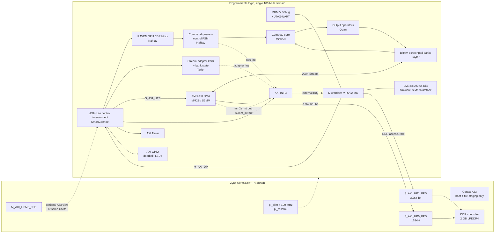
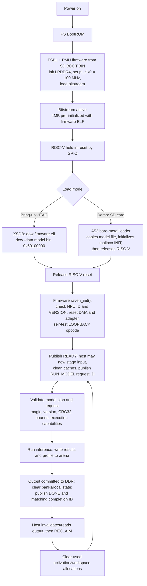
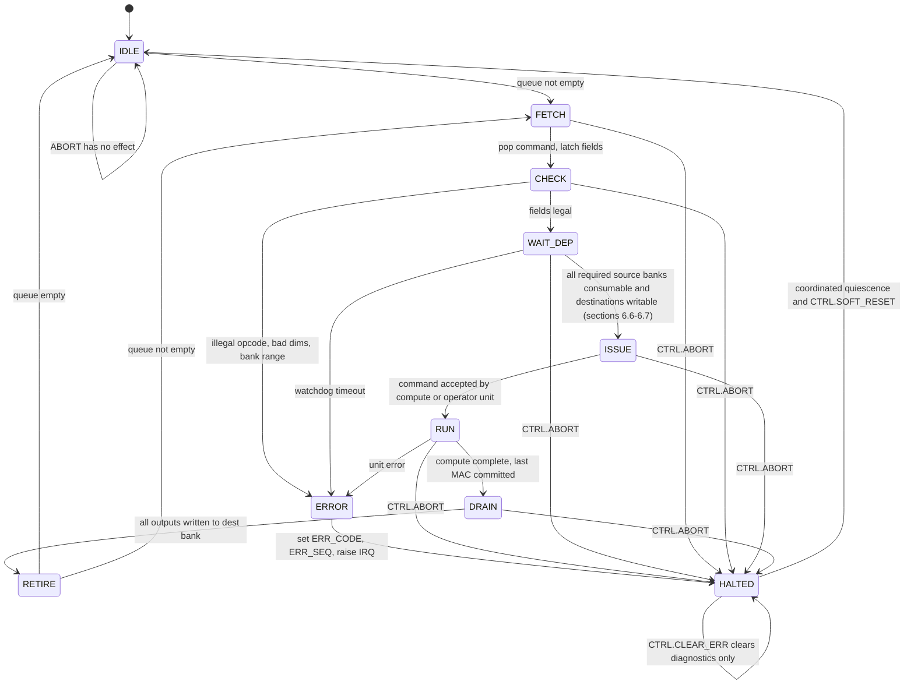
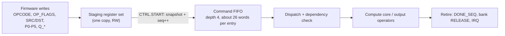
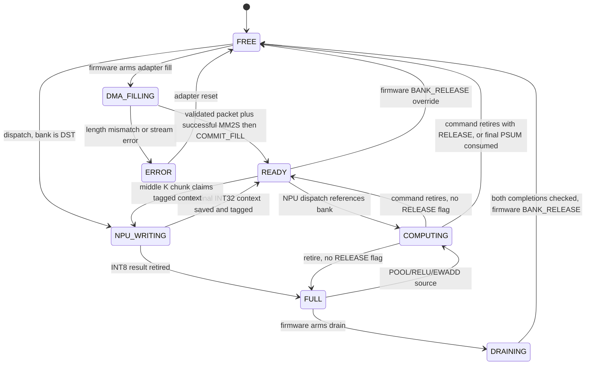
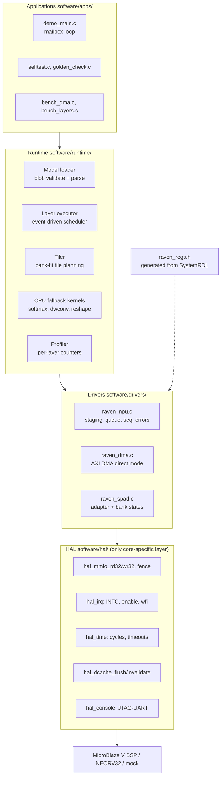
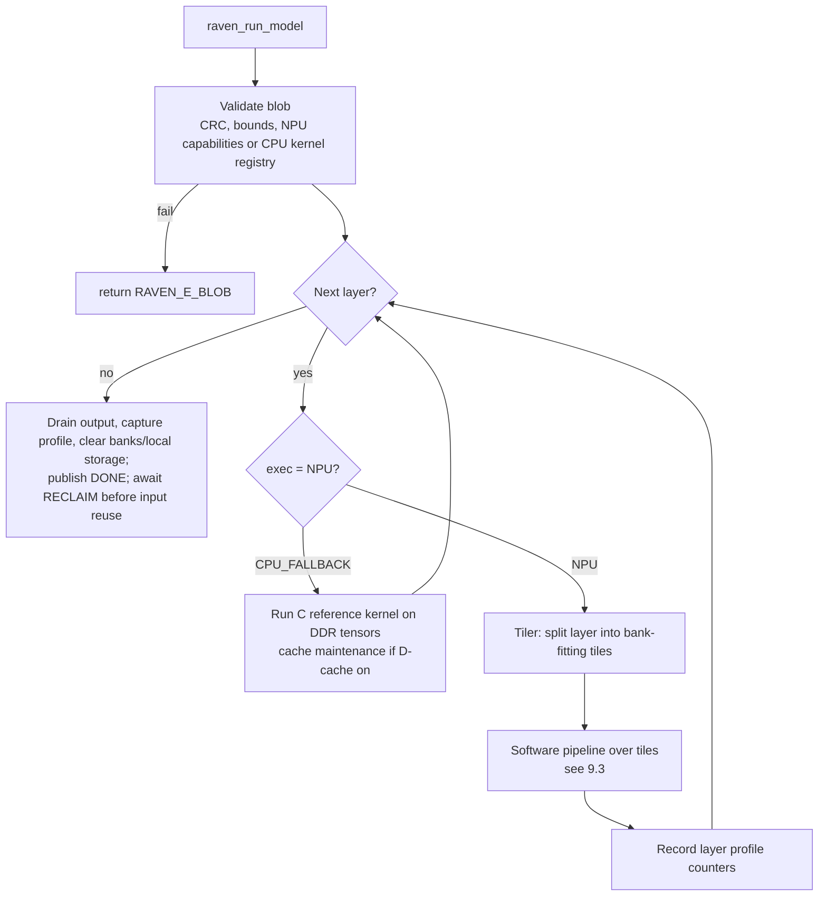

# RAVEN RISC-V Integration, MMIO Control, and Runtime

**Status:** Control-plane design specification. RTL and firmware implementation start at milestone M2 (§18).

**Owner:** Nahjay. Covers RISC-V integration, MMIO and control, the runtime, and firmware/software.

**Target:** AMD/Avnet Ultra96-V2 (Zynq UltraScale+ MPSoC ZU3EG).

This document covers RAVEN's control plane:

- the RISC-V soft processor;
- how it reaches the NPU, DMA, and scratchpad through memory-mapped registers;
- the hardware control logic behind those registers;
- the firmware/runtime that turns a model into hardware commands.

It builds directly on [NPU_ARCHITECTURE.md](NPU_ARCHITECTURE.md) (Michael, compute core) and [RAVEN_Memory_System_Research.md](RAVEN_Memory_System_Research.md) (Taylor, memory/DMA). Where those documents leave an interface to "agree with Nahjay," this document **proposes** a definition for the team to review.

**Shared baseline revision 0.2 (2026-10-23).** The [interface contract](interfaces/RAVEN_INTERFACE_CONTRACT.md) defines selected proposed behavior for row-block operand delivery, DMA tails/COMMIT_FILL, capabilities, mailbox ownership, CPU/NPU constants, and cancellation/recovery. The [project plan](PROJECT_PLAN.md) owns common targets, dates, and milestone leads. This document supplies the detailed proposed register/driver view; it does not establish implemented RTL, working firmware, tested tool pins, or measured performance. §21 tracks implementation checkpoints. The vendor DMA map follows PG021.

**Earlier shared-interface revision (2026-10-22, amended by revision 0.2).** The baseline keeps fallback kernels on the RISC-V, uses one result lane for bring-up with four lanes as an evaluation configuration, widens POOL strides, allocates EWADD's common pre-shift, and explicitly names a continuation's PSUM source and row pitch. Parameter records provide per-output bias even when requantization uses a shared scale. Implementation and verification remain outstanding; the current shared contract supersedes older conflicting descriptions.

**Revision (2026-10-23).** Replaced next-run cleanup with explicit RECLAIM; retained output until acknowledgment; specified valid-byte DMA packets and a successful-MM2S commit before READY; added timer-driven waits, recovery-generation tickets, test capabilities, a measurable T5, and model-specific acceptance. These remain proposed implementation requirements.

**Revision (2026-10-22).** Defined how a completed `FULL` output bank becomes a source for POOL, RELU, or EWADD, with ownership rules and a Conv → Pool → DMA command/state example (§5.1, §6.7, §6.8); made in-place INT32 → INT8 conversion conditional on the compute/output traversal agreement, with a staging fallback (§6.6).

**Revision (2026-10-21).** Fixed the bank-ID encoding in the §10 example; defined the partial-sum bank lifecycle (§6.6–6.7); resolved the parked-fill vs. `FREE`-bank conflict (§6.7, §9.3); completed the GEMM A-operand and Conv output-channel layout contract (§6.4, §8.3, §9.2); corrected the scratchpad budget (§11.3); widened the `STATUS` FSM field (§5.1, §6.2); and marked shared decisions as proposed.

---

## 0. Feedback traceability

| Instructor comment (section) | Where this document addresses it |
|---|---|
| Prior art: single clauses, no description or tradeoffs | §2: how each reference controls its accelerator, its tradeoffs, and what RAVEN takes from it |
| Differentiation: "lasting educational tool" unsupported | §15: single-source register spec, host-testable drivers, scripted builds, pinned versions, an "add an opcode" walkthrough, and a handoff acceptance test |
| Tangible impact: generic, hedged | §16: verifiable outcomes with explicit baselines (one firmware binary runs ≥3 models; measured control overhead) |
| Ethical considerations | §14: programmable DMA as a memory-access risk, address allowlisting, blob validation, zeroization, demo-data policy, and the limits of "local = private" |
| Drawbacks: no severity/likelihood | §17: risk register with severity, likelihood, mitigation, and warning signal |
| Performance: no real targets | §11: control-plane targets (command overhead, IRQ latency, NPU idle fraction, footprint) with a control-overhead model |
| Dependencies: essentially none listed | §12: hardware and software dependency table with version pins |
| Target dates: no calendar dates | §18: dated subsystem milestones |
| Individual accountability | §19: owner per deliverable and per cross-team interface |
| Accessibility/maintenance: no handoff plan | §15 |
| Milestones: need acceptance criteria | §13: measurable pass condition per milestone |
| Mockups: no DMA registers, undefined PARAM_DIM packing, no Element-wise Add opcode, no software or dataflow mockup | §6 (full NPU register map with per-opcode parameter packing and EWADD = `0x06`), §7 (DMA and scratchpad-adapter registers), §8–§10 (software stack, execution flow, and tensor dataflow diagrams, C API, worked register-level example) |
| Mockup readability: pixelated, long and narrow | Every diagram here is Mermaid, which renders to SVG on GitHub and exports to vector PDF/SVG with `mermaid-cli`. The overview, control detail, and software/dataflow are separate figures (§20). |

---

## 1. Role of the control plane and design summary

The RISC-V core is the **control plane**: it decides what the NPU and DMA do and when. It is **not on the data path**. Bulk NPU operand/result transfers follow DDR → DMA → scratchpad → compute → scratchpad → DMA → DDR. CPU fallback, C3 repacking, and cleanup do access tensor bytes on the RISC-V; include their cost in model latency rather than extending the bulk-path claim to them.

All rows below describe the selected **design proposal**; §21 records the implementation/evidence checkpoints.

| Decision | Proposed choice | Section |
|---|---|---|
| Processor | **AMD MicroBlaze V** (RV32IMC, no MMU, LMB local memory) as the baseline. **NEORV32** is the open-source fallback. Firmware is portable through a thin HAL. | §3 |
| Clocking | One 100 MHz PL clock domain (`pl_clk0`) for the RISC-V, the AXI4-Lite control interconnect, the NPU, and the DMA. No clock-domain crossing in the baseline. | §4 |
| Control coupling | Loosely coupled MMIO over AXI4-Lite, not custom instructions | §2, §5 |
| NPU register interface | 4 KiB CSR block with ID/version, a **staging register set + command queue (depth 4)**, sequence-tagged completion, per-opcode parameter packing, and performance counters | §6 |
| Command granularity | One command = one **bank-resident tile operation**: the hardware loops over M/N/K microtiles internally; the firmware loops over tiles and layers | §6.6, §11 |
| Operand addressing | NPU registers name **scratchpad bank + offset**, never DDR addresses. DDR addresses appear only in DMA registers. This corrects the draft's `ADDR_IN/ADDR_WEIGHT/ADDR_OUT`. | §6.4 |
| Data dependencies | Hardware waits for each required source to become consumable under its opcode-specific READY/FULL rules (with a watchdog). Firmware can queue DMA and compute in program order and get overlap without busy-waiting. | §6.7 |
| DMA control | AMD AXI DMA (PG021) direct-register mode, driven by RAVEN firmware, plus a RAVEN **stream-adapter CSR block** that tells the adapter which bank, offset, and byte count to use | §7 |
| Completion | Polling for bring-up; then an interrupt-driven event loop through AXI INTC | §9.4 |
| Runtime | Bare-metal, single-threaded C. A **data-driven layer executor** interprets a model blob, so one firmware binary runs every supported model. Unsupported operators fall back to C reference kernels on the RISC-V. | §8, §9 |
| Single source of truth | Registers are described once in SystemRDL. PeakRDL generates the SystemVerilog CSR block, the C header, and the HTML/Markdown documentation. | §6.9, §15 |

---

## 2. Prior art: how other accelerators are controlled

The compute document compares MAC-array organizations. This section compares **control-plane** organizations, the part RAVEN's RISC-V owns.

### 2.1 VTA (Versatile Tensor Accelerator, Apache TVM)

**How it works.** A host CPU writes a stream of VTA instructions (LOAD, GEMM, ALU, STORE) into DRAM and starts a **fetch module** through a few MMIO registers. The fetch module reads the instructions and dispatches them to three queues: load, compute, and store. Each queue runs its own module. Explicit **dependency tokens** between the queues let a load of tile *n+1* overlap compute on tile *n* and the store of tile *n−1* without CPU involvement. [VTA](https://tvm.apache.org/2018/07/12/vta-release-announcement.html)

**Tradeoffs.**

- It needs very little CPU effort per tile, and the decoupled access-execute overlap is enforced in hardware.
- It needs a compiler (TVM) to generate correct instruction streams and dependency tokens. A token error deadlocks or corrupts silently, and the instruction-fetch hardware is extra RTL to verify.

**What RAVEN takes.**

- Overlap comes from **hardware-enforced dependencies, not CPU polling**. RAVEN gets a lighter version from bank-state interlocks (§6.7): the bank `READY` state acts as the dependency token.
- RAVEN does not implement instruction fetch from DDR in the baseline. The RISC-V acts as the "fetch module" in software, which is easier to debug. A descriptor-fetch sequencer is a later extension (§9.6).

### 2.2 Gemmini (UC Berkeley)

**How it works.** Gemmini is tightly coupled to a Rocket or BOOM RISC-V core through the **RoCC** custom-instruction interface. Software issues custom instructions (`config`, `mvin`, `mvout`, `compute`, and loop instructions such as `LOOP_WS`) directly from the CPU pipeline. Hardware **loop unrollers** expand a whole tiled matmul or conv from a few instructions. Gemmini shares the CPU's virtual address space through its own TLB. [Gemmini](https://github.com/ucb-bar/gemmini)

**Tradeoffs.**

- Command issue latency is very low, there is no bus round-trip per register, and virtual memory is integrated.
- It is tied to the Rocket Chip generator (Chisel), and it needs a CPU with a RoCC port. Recreating that on a vendor or soft core is a large project, and the hardware is hard to inspect from a debugger.

**What RAVEN takes.**

- Coarse commands that hardware expands into many MACs. RAVEN commands are bank-resident tile operations, not per-MAC or per-microtile instructions (§6.6).
- RAVEN uses MMIO instead of custom instructions, so any RISC-V core with an AXI master can control it. A debugger can also poke every register (`mwr`/`mrd` in XSDB).

### 2.3 NVDLA (NVIDIA Deep Learning Accelerator)

**How it works.** Each NVDLA hardware unit is configured through a register interface (CSB). Every unit has **two register groups ("ping-pong")**: while the active group drives the current layer, the controller programs the shadow group for the next layer, so register programming latency is hidden. In the "small" configuration, a dedicated microcontroller performs this programming instead of a big application CPU. [NVDLA hardware architecture](http://nvdla.org/hw/v1/hwarch.html)

**Tradeoffs.**

- Programming overhead is hidden behind execution, and the register interface is debuggable.
- The register count is large. Firmware must track which group is active, and the interrupt handling is involved.

**What RAVEN takes.** RAVEN follows the "small NVDLA" model most closely: a microcontroller-class core programs an accelerator through registers. RAVEN generalizes ping-pong groups into a **staging register set + small command queue** (§6.5). Firmware writes the next command while the current one runs.

### 2.4 FINN (AMD/Xilinx)

**How it works.** FINN generates a network-specific streaming dataflow pipeline. Each layer becomes its own hardware block, so there is almost no runtime control: a host driver (typically Python/PYNQ on the ARM cores) starts DMA of the input and reads the output. [FINN](https://xilinx.github.io/finn/)

**Tradeoffs.**

- Control is minimal and throughput per network is high.
- The generated pipeline is specialized to a graph and folding configuration; changing its architecture can require a new bitstream. Compatible weights can be changed at runtime with supported memory modes, so a new model does not universally require re-synthesis. [FINN runtime-weight FAQ](https://finn.readthedocs.io/en/latest/faq.html#how-do-i-configure-external-mem-mode-for-weights)

**What RAVEN takes.** RAVEN proposes scheduling supported operations across different graphs on a reusable engine. Test that goal by running the selected three models from one bitstream and one firmware binary (§16); this is a RAVEN acceptance target, not a claim that FINN cannot reuse hardware or weights.

### 2.5 CFU Playground (Google)

**How it works.** Small accelerators are added as **Custom Function Units** to a VexRiscv soft core through RISC-V custom instructions. The CPU stays on the data path: it loads operands into registers, issues the custom instruction, and reads results back. [CFU Playground](https://github.com/google/CFU-Playground)

**Tradeoffs.**

- It is easy to start with, very educational, and fully open source.
- Throughput is limited by the CPU moving every operand, which is exactly the bottleneck RAVEN avoids with DMA and scratchpads.

**What RAVEN takes.**

- The "keep the CPU off the data path" principle, learned by contrast.
- The educational packaging: step-by-step tutorials and host-runnable tests.

### 2.6 Summary of control-coupling options

| Coupling | Example | Per-command issue cost | Core portability | Debuggability | RAVEN fit |
|---|---|---|---|---|---|
| Custom instructions (tight) | Gemmini RoCC, CFU | Lowest | Needs a core with a custom-instruction port | Low (inside the pipeline) | Rejected: ties RAVEN to one core |
| MMIO registers (loose) | NVDLA small, VTA start registers | Bus round-trip per register (budgeted at ≤ 20 cycles, T2) | Any core with an AXI master | High (XSDB can read and write every register) | **Selected.** Overhead amortized by coarse commands and a queue |
| Instruction stream fetched from DDR | VTA | Lowest CPU cost per tile | Any | Medium (needs a trace) | Later extension (§9.6) |
| Fixed streaming pipeline | FINN | None | n/a | n/a | Opposite of RAVEN's goal |

---

## 3. RISC-V core selection

### 3.1 Why a soft RISC-V when the ZU3EG has ARM Cortex-A53 cores?

The project premise is a RISC-V-controlled NPU. The engineering reasons:

1. **Portability.** The RAVEN NPU plus a soft RISC-V core moves to FPGAs without a hard processor (Artix/Kintex), and conceptually to an ASIC flow (README Future Extensions).
2. **Open ISA for teaching.** Students can read the ISA specification and, with an open core, the processor RTL.
3. **The cost of a soft-core control plane is part of what RAVEN measures** (§11).

The A53 cores are still used, but only for **board boot and file staging** (§4.4). They take no part in inference control.

### 3.2 Candidates

| Core | Language / license | ISA (relevant config) | Bus | Debug on Ultra96-V2 | Strengths | Weaknesses |
|---|---|---|---|---|---|---|
| **MicroBlaze V** (AMD) | Vivado IP, encrypted; ships with Vivado | RV32I (or RV32E / RV64I) with optional M, A, C, F/D, Zba/Zbb/Zbc/Zbs; Zicntr counters on by default; optional Zihpm, PMP, MMU | AXI4 (peripheral/cache), LMB (local BRAM), AXI4-Stream | MDM V (PG428) over the board JTAG pod: XSDB/Vitis debugger, mandatory parts of the RISC-V Debug Spec, JTAG-UART | Native Vivado block-design flow, Vitis BSP, caches/interrupts/debug ready-made, one vendor toolchain | Closed RTL, cannot simulate in Verilator, needs Vivado ≥ 2024.1 (UG1629 marks some features early access in 2024.1) |
| **NEORV32** | VHDL, BSD-3 | RV32I + many optional extensions | Internal bus with an AXI4 wrapper for Vivado IP packaging | On-chip debugger (RISC-V debug spec) needs its own JTAG pins or a BSCAN bridge | Exceptionally documented, open, education-oriented, built-in peripherals | VHDL in a SystemVerilog project, debug wiring takes extra work, more integration effort |
| **VexRiscv** | SpinalHDL (Scala) → Verilog, MIT | RV32I with M/C, highly configurable | AXI4 / Wishbone plugins | Via LiteX / OpenOCD | High performance per LUT, LiteX ecosystem, used by CFU Playground | Needs a Scala/SBT toolchain to regenerate, steeper learning curve |
| **PicoRV32** | Verilog, ISC | RV32IMC | Native AXI4-Lite variant (`picorv32_axi`) | None built in (UART printf only) | Tiny, trivial to simulate in Verilator, easy to read | CPI ≈ 4, non-standard IRQ scheme, no caches or debugger |
| **Ibex** (lowRISC) | SystemVerilog, Apache-2.0 | RV32IMC | OBI; needs an OBI→AXI bridge | Separate debug module | Industrial-grade verification, SystemVerilog | Bridge and debug-module integration is substantial work |

Sources: [MicroBlaze V UG1629](https://docs.amd.com/r/en-US/ug1629-microblaze-v-user-guide/Features), [NEORV32](https://github.com/stnolting/neorv32), [VexRiscv](https://github.com/SpinalHDL/VexRiscv), [PicoRV32](https://github.com/YosysHQ/picorv32), [Ibex](https://github.com/lowRISC/ibex).

### 3.3 Weighted selection

Weights reflect a one-academic-year schedule, where integration risk dominates raw CPU performance. The control plane is not compute-bound (§11). Scores run from 1 (poor) to 5 (good).

| Criterion | Weight | MicroBlaze V | NEORV32 | VexRiscv | PicoRV32 | Ibex |
|---|---:|---:|---:|---:|---:|---:|
| Vivado block-design integration effort | 30% | 5 | 3 | 3 | 4 | 2 |
| On-board debug (breakpoints, memory inspection) | 20% | 5 | 3 | 3 | 1 | 3 |
| Simulation / openness (teaching, Verilator) | 15% | 2 | 5 | 4 | 5 | 5 |
| Interrupts + timer + standard CSRs | 15% | 5 | 5 | 4 | 2 | 5 |
| Toolchain simplicity (one install) | 10% | 5 | 4 | 2 | 4 | 3 |
| Performance (CPI) for fallback kernels | 10% | 4 | 3 | 5 | 1 | 4 |
| **Weighted total** | 100% | **4.45** | 3.70 | 3.40 | 2.95 | 3.40 |

**Recommendation.**

- **MicroBlaze V** is the proposed control core, pending team ratification at M1 (§21). UG1629 documents the needed AXI/LMB interfaces and configuration parameters ([2024.2 configurability](https://docs.amd.com/r/2024.2-English/ug1629-microblaze-v-user-guide/MicroBlaze-V-Core-Configurability)), but the choice is confirmed only by an actual project build and integration check (M1–M2).
- The firmware HAL (§8.2) isolates every core-specific item: MMIO accessors, interrupt enable/claim, cache maintenance, cycle timer. The drivers and runtime can therefore be rebuilt for **NEORV32 or PicoRV32** without code changes.
- Optionally, PicoRV32 serves as a **simulation stand-in**. Because the NPU is MMIO-only, the same firmware ELF logic can run against the RAVEN RTL in Verilator, which cannot simulate the encrypted MicroBlaze V. On-board work and Vivado `xsim` use MicroBlaze V.

**MicroBlaze V configuration.** Parameter names are from UG1629 "MicroBlaze V Core Configurability"; several default to 0, so they must be set explicitly.

| Parameter | Value | UG1629 default | Reason |
|---|---|---|---|
| `C_DATA_SIZE` / `C_ADDR_SIZE` | 32 / 32 | 32 / 32 | RV32; all RAVEN addresses fit in 32 bits (§4.3) |
| `C_USE_MULDIV` | 1 (Normal) | 0 | M extension, needed for requant/fallback math |
| `C_USE_COMPRESSION` | 1 | 0 | C extension, code density in LMB |
| `C_USE_COUNTERS` | 1 | 1 | Zicntr, so `rdcycle` gives a cycle counter without a bus access (used for T2–T5 in §11) |
| `C_USE_FPU` | 0 | 0 | No floating point in the integer runtime |
| `C_USE_MMU` | 0 (Machine mode) | 0 | Bare-metal, no virtual memory |
| `C_USE_ICACHE` / `C_USE_DCACHE` | 0 / 0 | 0 / 0 | Code runs from single-cycle LMB, and DDR accesses are rare (§4.5) |
| `C_PMP_ENTRIES` | 0 for bring-up; 4–8 after M5 | Configurable 0–64 | Optional CPU-side memory protection (§14) |
| `C_DEBUG_ENABLED` / `C_DEBUG_INTERFACE` | 1 / 0 (serial, to MDM V) | 1 / 0 | JTAG debug through XSDB |
| `C_NUMBER_OF_PC_BRK` | 2–4 | 1 | More than one hardware breakpoint for bring-up |

Outside the core:

- 64 KiB LMB instruction/data BRAM;
- AXI4 peripheral data port;
- MDM V with its JTAG-UART enabled (PG428 describes a UART carried over JTAG to XSDB that behaves like AXI UART Lite);
- AXI INTC merging the RAVEN interrupt sources into the core's external interrupt. UG1629 also documents a low-latency vectored interrupt mode, to be evaluated if T5 is missed.

Freeze the configuration after the first synthesis (§13 M1).

The team ratifies the core at M1 (§21). An open core strengthens the education claim; MicroBlaze V lowers schedule risk, which is why it is the recommendation.

---

## 4. System integration on the Ultra96-V2

### 4.1 Control-plane block diagram



*Figure 1: control-plane overview. Solid lines are data and control buses; dashed lines are interrupts, clock, and optional paths.*

### 4.2 Port and clock choices

| Item | Choice | Reasoning |
|---|---|---|
| DMA → DDR | `S_AXI_HP0_FPD`, 128-bit (Taylor's preferred width) | Noncoherent high-performance port; RAVEN manages coherency explicitly (§4.5). [PG201](https://docs.amd.com/r/en-US/pg201-zynq-ultrascale-plus-processing-system/Slave-Interface) |
| RISC-V → DDR | Separate `S_AXI_HP1_FPD` | RISC-V DDR reads (layer table, fallback kernels) do not share an interconnect with the 128-bit DMA stream. They still contend inside the DDR controller, and that is measured. |
| RISC-V → CSRs | AXI4-Lite through SmartConnect, all slaves in PL | Keeps control traffic entirely in the PL. No PS round-trip. |
| Clock | One `pl_clk0` at 100 MHz (README target) for the RISC-V, control interconnect, NPU, adapter, and DMA | **No CDC** between the CSR block and the NPU control FSM. CDC bugs are a top integration risk. A faster NPU clock is a later optimization that needs CDC on the CSR-to-queue boundary. |
| Reset | `proc_sys_reset` driven by `pl_resetn0`, plus a GPIO-controlled RISC-V reset hold so the A53 can release the RISC-V after staging files | Deterministic boot ordering (§4.4) |

### 4.3 Address maps

**Design rule: DDR addresses are identical for the RISC-V and the DMA.** Both reach DDR through PS HP ports, which present the PS physical map (`DDR_LOW` = `0x0000_0000–0x7FFF_FFFF`). A pointer in a model blob can be written into a DMA address register without translation. All RAVEN DDR addresses fit in 32 bits, so the DMA `*_MSB` registers are always 0.

**RISC-V view (set in the Vivado Address Editor).**

| Range | Size | Target | Notes |
|---|---|---|---|
| `0x0000_0000–0x7FFF_FFFF` | 2 GB | DDR via `S_AXI_HP1_FPD` | Firmware only touches the RAVEN arena below; the driver allowlist enforces this (§14) |
| `0x8000_0000–0x8000_FFFF` | 64 KiB | LMB BRAM | Reset vector `0x8000_0000`. Placed above DDR because the HP segment occupies `0x0` |
| `0xA000_0000–0xA000_0FFF` | 4 KiB | **RAVEN NPU CSR** (§6) | Nahjay |
| `0xA001_0000–0xA001_FFFF` | 64 KiB | **AMD AXI DMA** (PG021 register map, §7.1) | Taylor (IP config), Nahjay (driver) |
| `0xA002_0000–0xA002_0FFF` | 4 KiB | **RAVEN stream-adapter / bank CSR** (§7.2) | Taylor (RTL), Nahjay (driver) |
| `0xA003_0000–0xA003_FFFF` | 64 KiB | AXI INTC | |
| `0xA004_0000–0xA004_FFFF` | 64 KiB | AXI Timer (cycle and timeout measurement) | |
| `0xA005_0000–0xA005_FFFF` | 64 KiB | AXI GPIO (doorbell from the A53, RISC-V reset hold, LEDs) | |

The peripheral window sits at `0xA000_0000` because it matches the PS `M_AXI_HPM0_FPD` aperture, so if the A53 is also connected (dashed path in Figure 1), **both processors see the same CSR addresses**. A53-side debug tools can then reuse the generated C header.

**RAVEN DDR arena.** The arena is the DDR region RAVEN owns. Everything outside it is off-limits to RAVEN DMA.

| Range | Size | Contents | Writer → reader |
|---|---|---|---|
| `0x6000_0000–0x6000_0FFF` | 4 KiB | Mailbox / control block (§4.4) | A53 ↔ RISC-V |
| `0x6010_0000–0x63FF_FFFF` | ~63 MB | Model blobs: header, tensor/layer tables, pre-packed weights, per-channel params | Loader → RISC-V (tables), DMA (weights) |
| `0x6400_0000–0x67FF_FFFF` | 64 MB | Activation arena: input, intermediate, and output tensors (NHWC INT8) | DMA ↔ DMA, RISC-V for fallback ops |
| `0x6800_0000–0x680F_FFFF` | 1 MB | Profiling trace and log ring buffer | RISC-V → host |
| `0x6900_0000–0x6FFF_FFFF` | ~112 MB | Test vectors and golden references (verification builds only) | Loader → RISC-V |

The DMA allowlist is `[0x6000_0000, 0x7000_0000)`. If Linux ever runs on the A53, the arena must be a device-tree `reserved-memory` node.

### 4.4 Boot and handoff flow



*Figure 2: boot and handoff sequence.*

Mailbox (control block at `0x6000_0000`):

```c
typedef struct {
    uint32_t magic;          // 0x5241564E 'RAVN'
    uint32_t version;        // mailbox ABI version (revision 0.2 definitions)
    volatile uint32_t cmd;   // 0 idle, 1 RUN_MODEL, 2 SELF_TEST, 3 SHUTDOWN, 4 RECLAIM
    volatile uint32_t status;// 0 READY, 1 BUSY, 2 DONE, 3 CLEARING, 4 STOPPED, 5 INIT; high bit = terminal fault
    uint32_t model_addr;     // DDR address of model blob
    uint32_t input_addr;     // DDR address of input tensor
    uint32_t output_addr;    // DDR address for output tensor
    uint32_t output_bytes;   // filled by RISC-V
    uint32_t cycles_lo, cycles_hi; // total inference cycles
    uint32_t profile_addr;   // DDR address of per-layer profile records
    volatile uint32_t request_id;           // host publishes last
    volatile uint32_t completed_request_id; // runtime publishes last
    uint32_t response_code;                 // request error; separate from lifecycle
    uint32_t reserved[2];
} raven_mailbox_t;           // 64 bytes, cache-line aligned
```

The loader initializes INIT; only firmware publishes READY after initialization. One request is outstanding at a time. RUN_MODEL is legal only in READY. After reading output, RECLAIM clears used allocations and returns READY; SHUTDOWN clears them and enters STOPPED. Invalid-state requests return response_code without changing lifecycle/ownership. Match request/completion IDs, publish IDs after ordered payload/status writes, and invalidate old IDs on a new runtime session. See the [mailbox/cache contract](interfaces/RAVEN_INTERFACE_CONTRACT.md#4-mailbox-ownership-and-cleanup).

**Ultra96-V2 detail.** The board has no on-board JTAG header connector for debug. RISC-V download and debug need the Avnet JTAG/UART pod (AES-ACC-U96-JTAG), listed in §12. The PL clock and DDR come from the PS, so **the PS must always be booted first**, either by FSBL from SD or by `psu_init` through XSDB.

### 4.5 Cache coherency and memory ordering

| Actor | Caching | Rule |
|---|---|---|
| MicroBlaze V | No caches in the baseline; code and stack in LMB | Uncached DDR access avoids a RISC-V cache copy; ownership, transfer completion, and fences still govern visibility to other masters. If a D-cache is enabled later for fallback-kernel speed, the driver calls `hal_dcache_flush(addr,len)` before an MM2S read of CPU-written data and `hal_dcache_invalidate(addr,len)` after an S2MM write the CPU will read. Buffers are aligned to the cache-line size. |
| A53 loader | Cached | Clean written model/input cache lines and complete the maintenance with the required A53 barriers before handoff. Map the shared mailbox uncached; if results are read through cached mappings, invalidate the output/profile ranges after successful completion before reading them. Cache-line alignment and exclusive buffer ownership prevent a stale dirty line from overwriting DMA results. |
| DMA via HP0 | Noncoherent | Never snoops caches. Use the maintenance/ownership rules above. Moving to HPC requires reviewed transaction attributes and PS snoop configuration; port selection alone does not establish coherency. [AMD coherency example](https://xilinx-wiki.atlassian.net/wiki/spaces/A/pages/18842098/Zynq%2BUltraScale%2BMPSoC%2BCache%2BCoherency). |

**MMIO ordering rules for the driver.**

1. All CSR accesses use ordered 32-bit HAL operations to uncached I/O mappings. `volatile` prevents compiler removal; it does not supply the hardware ordering contract.
2. The HAL must implement the selected core/interconnect's documented write-completion and I/O-fence rules. Before starting DMA, fence after ARM_FILL, read/check the adapter's FILL_BUSY status (bounded polling), then fence before the DMA writes. A status read by itself is not a universal ordering guarantee across AXI read/write channels or different slaves.
3. A `fence iorw, iorw` orders staging-register writes before CTRL.START. Verify the implemented HAL/core path with register-trace and integration tests.
4. CPU-written DMA inputs must reach shared memory before DMA starts: perform cache maintenance if applicable, complete it, then fence and program DMA. Observe successful S2MM completion before reading or reusing its destination. The A53 uses its own architectural barrier/cache-maintenance instructions. [RISC-V memory-ordering specification](https://docs.riscv.org/reference/isa/unpriv/rv32.html).

---

## 5. Control logic architecture (hardware owned by this subsystem)

These RTL blocks live in `rtl/control/`:

| Block | Function |
|---|---|
| `raven_csr` (generated by PeakRDL-regblock from SystemRDL) | AXI4-Lite slave. Holds ID/config, staging registers, status, IRQ, error, and counters. Always responds within a bounded number of cycles, never waiting on the compute core, so a busy NPU cannot hang the CPU bus. |
| `raven_cmd_queue` | Snapshots the staging set into a FIFO entry on `CTRL.START` (depth 4). Assigns a 16-bit sequence number. Reports occupancy. |
| `raven_dispatch` | Pops a command, checks it (opcode legal, dims non-zero and within hardware limits, bank/offset ranges), **waits for referenced banks to be consumable** (`READY`, or `FULL` for an output-op source; §6.7), then hands a decoded command to Michael's compute controller or Quan's operator units. |
| `raven_complete` | Watches for *command completion*: all outputs written to the destination bank. Applies `RELEASE_*` bank transitions, updates `DONE_SEQ`, and raises the IRQ. |
| `raven_perf` | Cycle counters: total, busy, compute-active, input-stall, output-stall, dependency-wait, and MACs committed. |

### 5.1 Control FSM



*Figure 3: NPU command FSM.*

The FSM has ten states, so `STATUS.FSM_STATE` is a **4-bit** field (`STATUS[8:5]`, §6.2):

| Code | State | Code | State |
|---|---|---|---|
| 0 | IDLE | 5 | RUN |
| 1 | FETCH | 6 | DRAIN |
| 2 | CHECK | 7 | RETIRE |
| 3 | WAIT_DEP | 8 | ERROR |
| 4 | ISSUE | 9 | HALTED |

Codes 10–15 are reserved.

**Completion definitions.** These answer Michael's request to define the events with Nahjay and Taylor.

| Event | Meaning | Visible to firmware as |
|---|---|---|
| Compute complete | Last product of the command committed in the MAC array | Internal only. A performance-counter boundary (`CYC_COMPUTE`). |
| **Command complete** (`DONE`) | Every output element of the command is in the destination bank, and bank state transitions are applied | `DONE_SEQ` = this command's sequence number, `IRQ_STATUS.DONE` |
| DMA complete | Fill: packet validated, successful MM2S observed, then COMMIT_FILL makes bank READY. Drain: successful S2MM and adapter stream completion checked. | Adapter FILL_DONE/AWAIT_COMMIT, DMA status, explicit commit/release |
| Inference complete | Firmware has drained the final output to DDR | Mailbox `status = DONE` |

Once an error halts the queue, later queued commands are **not** executed. CLEAR_ERR does not resume them. Cancel the software list and perform the coordinated recovery in the [shared contract](interfaces/RAVEN_INTERFACE_CONTRACT.md#6-timed-waits-recovery-and-completion-tickets); wait for QUIESCENT before storage reuse. A 1 ms timer drives bounded software waits for RUN/DRAIN and lost interrupts in addition to the dependency watchdog. SOFT_RESET cancels/quiesces active local execution before flushing and returning IDLE; it does not erase BRAM.

---

## 6. NPU register map (resolves the "Mockup content" comments)

All registers are 32-bit, word-aligned, at offsets from `NPU_BASE = 0xA000_0000`.

- Accesses with `WSTRB ≠ 0xF`, and accesses to unmapped offsets, return **SLVERR**. On the RISC-V this raises a load or store access-fault exception, which the firmware trap handler logs.
- Access types:
  - **RO**: read-only.
  - **RW**: read/write.
  - **W1S**: write 1 to set; self-clearing.
  - **W1C**: write 1 to clear.

### 6.1 Old → new mapping

| Draft register (README) | Problem | Replacement |
|---|---|---|
| `CTRL 0x00` | Mixed start, reset, and interrupt bits; no queue semantics | `CTRL 0x010` (W1S actions) + `IRQ_ENABLE 0x018` |
| `STATUS 0x04` | No queue occupancy, no tag of what completed | `STATUS 0x014`, `DONE_SEQ 0x024` |
| `OPCODE 0x08` | EWADD missing | `OPCODE 0x030`, full table in §6.3, EWADD = `0x06` |
| `PARAM_DIM 0x0C–0x14` | Packing undefined | `P0–P5 0x040–0x054`, packed per opcode (§6.4) |
| `ADDR_IN/WEIGHT/OUT 0x18–0x20` | Ambiguous: DDR or scratchpad? The NPU only reads scratchpad, per the memory doc. | `SRC_A`, `SRC_B`, `DST`, `PARAM` as **scratchpad references** (§6.4). DDR addresses exist only in the DMA registers (§7). |
| (none) | No DMA registers | AXI DMA register usage (§7.1) and RAVEN adapter CSR (§7.2) |

### 6.2 Register table

| Offset | Name | Access | Reset | Fields |
|---|---|---|---|---|
| `0x000` | `ID` | RO | `0x5241_564E` | ASCII `RAVN`. The firmware's first sanity check. |
| `0x004` | `VERSION` | RO | build | `[31:24]` major, `[23:16]` minor, `[15:0]` build/patch. Firmware refuses to run if the major version differs from its header. |
| `0x008` | `HW_CONFIG` | RO | build | `[7:0]` array rows R, `[15:8]` array cols S, `[19:16]` number of banks, `[23:20]` log2(nominal ACT/WGT bank KiB; other bank capacities follow the versioned build table in §6.4), `[27:24]` command queue depth, `[31:28]` reserved |
| `0x00C` | `HW_LIMITS` | RO | build | `[15:0]` max dimension per field, `[31:16]` supported-opcode bitmap for `0x00–0x0F` |
| `0x010` | `CTRL` | W1S | 0 | [0] START; [1] SOFT_RESET cancels/quiesces and flushes queue, staging/IRQs/errors/counters and sequence state (no BRAM erase); [2] ABORT from any active phase; [3] CLEAR_ERR (diagnostics only, stays halted); [4] CNT_CLEAR; [5] ZERO_LOCAL (§14) |
| `0x014` | `STATUS` | RO | build | [0] BUSY, [1] HALTED, [2] ERROR, [3] Q_FULL, [4] Q_EMPTY, [8:5] FSM, [11:9] queue occupancy, [12] QUIESCENT, [13] LOCAL_ZERO_BUSY, [15:14] reserved, [31:16] executing sequence. Quiescent does not imply empty queue. |
| `0x018` | `IRQ_ENABLE` | RW | 0 | `[0]` DONE, `[1]` ERROR, `[2]` Q_SPACE (queue went from full to not full), `[3]` DEP_WAIT (debug) |
| `0x01C` | `IRQ_STATUS` | W1C | 0 | Same bits. The `npu_irq` output = OR of (IRQ_STATUS & IRQ_ENABLE). |
| `0x020` | `NEXT_SEQ` | RO | 0 | Sequence number the next START will receive (16-bit, wraps) |
| `0x024` | `DONE_SEQ` | RO | `0xFFFF` | Sequence number of the last command completed |
| `0x028` | `ERR_CODE` | RO | 0 | `[7:0]` code (§6.8), `[31:16]` sequence number of the failing command |
| `0x02C` | `ERR_INFO` | RO | 0 | Code-specific detail (for example, offending bank ID or field index) |
| `0x030` | `OPCODE` | RW (staging) | 0 | `[7:0]` opcode (§6.3) |
| `0x034` | `OP_FLAGS` | RW (staging) | 0 | `[0]` ACC_INIT, `[1]` ACC_LAST, `[2]` REQUANT_EN, `[3]` RELU_EN, `[5:4]` POOL_MODE (0 max, 1 avg), `[6]` PER_CHANNEL (per-output requant multiplier/shift from PARAM; bias delivery is independent), `[7]` SRC_A_CB (channel-blocked `SRC_A`; optional, proposed, §9.2), `[8]` RELEASE_A, `[9]` RELEASE_B, `[10]` RELEASE_PARAM, `[11]` DST_ACCUM (INT32 context storage/continuation, §6.6), `[31:12]` reserved |
| `0x038` | `SRC_A` | RW (staging) | 0 | Scratchpad reference (§6.4): activation input / EWADD input A |
| `0x03C` | `SRC_B` | RW (staging) | 0 | Weights (Conv/GEMM) / EWADD input B |
| `0x040`–`0x054` | `P0`–`P5` | RW (staging) | 0 | Per-opcode dimension packing (§6.4). Replaces `PARAM_DIM`. |
| `0x058` | `DST` | RW (staging) | 0 | Destination scratchpad reference |
| `0x05C` | `PARAM` | RW (staging) | 0 | Per-output records: bias is read on GEMM/CONV2D ACC_INIT regardless of PER_CHANNEL; multiplier/shift are read when per-channel requantization is enabled (§6.4) |
| `0x060` | `Q_ZP` | RW (staging) | 0 | `[7:0]` input A zero-point (int8), `[15:8]` input B zero-point (EWADD), `[23:16]` output zero-point (int8) |
| `0x064` | `Q_MULT` | RW (staging) | 0 | Per-tensor requant multiplier (int32, Q31), used when `PER_CHANNEL=0` |
| `0x068` | `Q_SHIFT` | RW (staging) | 0 | `[7:0]` output shift (signed), `[15:8]` input A shift (EWADD), `[23:16]` input B shift (EWADD) |
| `0x06C` | `Q_CLAMP` | RW (staging) | `0x7F80` | `[7:0]` activation min (int8), `[15:8]` activation max (int8). RELU is clamp-min = output zero-point. |
| `0x070` | `Q_MULT_A` | RW (staging) | 0 | EWADD input A rescale multiplier |
| `0x074` | `Q_MULT_B` | RW (staging) | 0 | EWADD input B rescale multiplier |
| `0x078` | `PSUM_SRC` | RW (staging) | 0 | **Proposed:** scratchpad bank/byte-offset reference to the existing INT32 context on a GEMM/CONV2D continuation; ignored on ACC_INIT |
| `0x07C` | `PSUM_PITCH` | RW (staging) | 0 | **Proposed:** `[15:0]` INT32 context row pitch in bytes; `[31:16]` reserved. Must match the saved context, be a multiple of 4, and cover the output channels |
| `0x080`/`0x084` | `CYC_TOTAL_LO/HI` | RO | 0 | Cycles since CNT_CLEAR |
| `0x088`/`0x08C` | `CYC_BUSY_LO/HI` | RO | 0 | Cycles with a command in RUN or DRAIN |
| `0x090` | `CYC_COMPUTE` | RO | 0 | Cycles the MAC array issued valid products |
| `0x094` | `CYC_STALL_IN` | RO | 0 | Cycles RUN waited on operand delivery |
| `0x098` | `CYC_STALL_OUT` | RO | 0 | Cycles RUN or DRAIN waited on output backpressure |
| `0x09C` | `CYC_DEP_WAIT` | RO | 0 | Cycles in WAIT_DEP (DMA not finished) |
| `0x0A0` | `CYC_IDLE_PENDING` | RO | 0 | Cycles idle with the queue empty. This raw idle counter can include DMA waits, fallback work, and workload boundaries; it does not by itself attribute idle time to firmware (§11). |
| `0x0A4`/`0x0A8` | `MAC_COUNT_LO/HI` | RO | 0 | Useful MACs committed (masked lanes excluded) |
| `0x0AC` | `CMD_COUNT` | RO | 0 | Commands retired |
| `0x0B0` | `HW_FEATURES` | RO | build | [0] T_LOOPBACK, [1] T_FILL, [2] ACT destination writes, [3] OUT1 present; [31:4] reserved zero |

The quantization fields (`Q_*`) follow Quan's proposed TFLM commit `c051fea55c4a6b4464186e1bb126708bea50f32e` with `TFLITE_SINGLE_ROUNDING=1` (operators research §§4–5). Positive signed Q_SHIFT scales up; multiplier ties follow that helper, not pooling's division rule. The EWADD common pre-shift is allocated to P1[7:0] (§6.4), separately from the three multiplier shifts. This reference/configuration and the fields remain subject to joint review; no golden execution is claimed here.

Validate 0x00–0x0F against HW_LIMITS and 0x80/0x81 against HW_FEATURES[0]/[1]; other opcodes are illegal. CPU fallback support uses a separate compiled kernel registry. SOFT_RESET sets NEXT_SEQ=0 and DONE_SEQ=0xFFFF and invalidates execution context. ZERO_LOCAL is legal only with QUIESCENT and Q_EMPTY; otherwise reject the action with AXI SLVERR. It blocks START until LOCAL_ZERO_BUSY clears and erases local operand/product/accumulator/result storage, preserving performance counters. Its completion must be bounded and verified in simulation.

### 6.3 Opcode table (adds Element-wise Add)

The README's draft values (`0x01–0x05`) are preserved, so existing documents stay valid.

| Opcode | Mnemonic | Unit | SRC_A | SRC_B | DST | Notes |
|---|---|---|---|---|---|---|
| `0x00` | `NOP` / `FENCE` | control | n/a | n/a | n/a | Completes when all earlier commands complete. A cheap synchronization point and IRQ trigger. |
| `0x01` | `CONV2D` | compute + output ops | Activation tile (NHWC) | Packed weights | OUT or PSUM | Implicit GEMM through the window frontend (compute doc §8) |
| `0x02` | `GEMM` | compute + output ops | A (M×K) | B, packed (K×N) | OUT or PSUM | Fully connected layers, 1×1 conv |
| `0x03` | `RELU` | output ops | INT8 tensor | n/a | OUT | Standalone form. Normally fused via `OP_FLAGS.RELU_EN`. |
| `0x04` | `POOL` | output ops | INT8 NHWC | n/a | OUT | `POOL_MODE` max/avg. Global average pool = window equal to the input. |
| `0x05` | `REQUANT` | output ops | Completed INT32 tensor | n/a | OUT | Standalone INT32 → INT8 from a READY, validated completed tensor; unfinished PSUM contexts are rejected. Normally fused on the last K chunk. |
| **`0x06`** | **`EWADD`** | output ops | INT8 input A | INT8 input B | OUT | **New.** Residual add: rescale A and B to a common scale, add, requantize, clamp. Needed by ResNet-style models. |
| `0x07` | `DWCONV` | reserved | n/a | n/a | n/a | Depthwise conv. Opcode reserved pending the Michael/Quan decision (compute doc §8). The runtime uses the CPU fallback until then (§9.5). |
| `0x08–0x7F` | reserved | | | | | Returns `ERR_ILLEGAL_OP` |
| `0x80` | `T_LOOPBACK` | test | Bank | n/a | Bank | Byte copy bank → bank. Tests control, dispatch, bank states, and DMA **without** the compute core, so Nahjay and Taylor can integrate before compute RTL exists. |
| `0x81` | `T_FILL` | test | n/a | n/a | Bank | Fill with the byte in `P0[7:0]`. Also used for **zeroization** (§14). |

With CONV2D, GEMM, RELU, POOL, REQUANT, and EWADD, the hardware covers the README's **six-operator minimum**. FC is GEMM; 1×1 conv is GEMM or CONV2D.

### 6.4 Scratchpad references and per-opcode parameter packing

**Scratchpad reference format** (`SRC_A`, `SRC_B`, `DST`, `PARAM`, `PSUM_SRC`):

```text
 31        28 27        24 23                                     0
+------------+------------+----------------------------------------+
|  BANK_ID   |  reserved  |             BYTE_OFFSET                 |
+------------+------------+----------------------------------------+
```

BYTE_OFFSET must be 16-byte aligned. Validate IDs against the versioned bank/presence table, not ID < number-of-banks: PRM stays ID 6 even when OUT1/ID 5 is absent. Include padded physical read spans and full B panels in bank-fit checks. The bank IDs follow Taylor's buffer plan plus PARAM:

| BANK_ID | Bank | Size (memory doc) | Contents |
|---|---|---|---|
| 0 | `ACT0` | 16 KiB | Activation ping |
| 1 | `ACT1` | 16 KiB | Activation pong / EWADD second input |
| 2 | `WGT0` | 16 KiB | Weight ping |
| 3 | `WGT1` | 16 KiB | Weight pong |
| 4 | `OUT0` | 8–16 KiB | INT8 output or INT32 partial sums (`DST_ACCUM`) |
| 5 | `OUT1` | optional | Output pong, if output double-buffering fits (Taylor) |
| 6 | `PRM` | **4 KiB (proposed additional allocation in Taylor's budget)** | Per-output records `{int32 bias_corrected, int32 multiplier, int8 shift, 7 B pad}` = 16 B/channel, so 256 output channels per tile. Bias is needed even when scales are per tensor; record byte offsets are defined in the shared contract; implementation must match. |

**Bias versus scale granularity (proposed).** GEMM/CONV2D ACC_INIT always reads one corrected-bias record per logical output channel from PARAM. PER_CHANNEL selects only the requant multiplier/shift source: record fields when 1, Q_MULT/Q_SHIFT when 0. Shared scale does not imply shared bias. AD01 therefore still supplies its per-neuron bias vector with PER_CHANNEL=0. Continuation does not add bias again; standalone REQUANT ignores bias fields. The exporter supplies validated INT32 seeds and zero seeds for a bias-free layer.

**Per-opcode parameter packing** (`P0–P5`). Unused fields must be written as 0; the dispatch check rejects non-zero reserved bits (`ERR_RSVD`).

| Opcode | P0 | P1 | P2 | P3 | P4 | P5 |
|---|---|---|---|---|---|---|
| `GEMM` | `[15:0]` M, `[31:16]` N | `[15:0]` K (this chunk) | `[15:0]` A row pitch (bytes) | `[15:0]` B panel pitch (bytes) | `[15:0]` OUT row pitch | 0 |
| `CONV2D` | `[15:0]` H_in, `[31:16]` W_in (tile, including halo) | `[15:0]` C_in, `[31:16]` C_out (tile) | `[7:0]` Kh, `[15:8]` Kw, `[19:16]` stride_h, `[23:20]` stride_w, `[27:24]` dil_h, `[31:28]` dil_w | `[7:0]` pad_top, `[15:8]` pad_bottom, `[23:16]` pad_left, `[31:24]` pad_right | `[15:0]` H_out, `[31:16]` W_out (tile) | `[15:0]` C_in chunk offset (K chunking over channels), `[31:16]` channel block size `cb` when `SRC_A_CB=1`, else 0 (optional C2, §9.2) |
| `POOL` | `[15:0]` H_in, `[31:16]` W_in | `[15:0]` C | `[7:0]` window_h, `[15:8]` window_w, `[23:16]` stride_h, `[31:24]` stride_w (8-bit strides) | pads as CONV2D | `[15:0]` H_out, `[31:16]` W_out | 0 |
| `EWADD` | `[23:0]` element count | `[7:0]` Q_EWADD_LEFT_SHIFT (unsigned 0–20); upper bits 0 | 0 | 0 | 0 | 0 |
| `RELU` / `REQUANT` | `[23:0]` element count | `[15:0]` channels (per-channel requant) | 0 | 0 | 0 | 0 |
| `T_LOOPBACK` | `[23:0]` byte count | 0 | 0 | 0 | 0 | 0 |
| `T_FILL` | `[7:0]` fill byte | `[23:0]` byte count | 0 | 0 | 0 | 0 |

Bit-level picture of the CONV2D `P2` geometry word:

```text
 31   28 27   24 23   20 19   16 15            8 7             0
+-------+-------+-------+-------+---------------+---------------+
| dil_w | dil_h |str_w  |str_h  |      Kw       |      Kh       |
+-------+-------+-------+-------+---------------+---------------+
  4 b     4 b     4 b     4 b         8 b             8 b
```

The 16-bit dimensions allow up to 65,535 per field. The hardware advertises its true limits in `HW_LIMITS`, and the firmware tiler never exceeds them.

**POOL and EWADD encoding (proposed).** POOL has its own P2 format; do not use the CONV2D stride packer. DS-CNN's 25×5 window and 25×5 strides encode as `P2=0x05190519`, so stride 25 is representable without truncation. Zero window/stride is invalid. `raven_pack_pool_p2()` validates all four fields before packing.

EWADD P1[7:0] names the common pre-shift before the two input rescalings. Its proposed RAVEN-supported range is 0–20, so centered INT8 values times 2^left_shift fit INT32. The exporter must derive matching multiplier/shift pairs from the pinned reference preparation; firmware must reject out-of-range fields or intermediate ranges. The pinned ADD path uses SmallerThanOneExp at all three scaling stages, so each EWADD multiplier shift must be in [-31, 0], with a nonnegative multiplier. Other requantization paths support the general helper's [-31, 30] range. This pre-shift is distinct from the signed input A/B and output multiplier shifts in Q_SHIFT. Other opcodes retain their own P1 meanings.

**Operand layouts (selected proposal).** Use the [shared port/address contract](interfaces/RAVEN_INTERFACE_CONTRACT.md#1-operand-and-result-delivery).

| Operand | Resident layout | Frontend owner/behavior |
|---|---|---|
| GEMM A | Row-major M×K, 16-byte-aligned P2/base | Michael: two 8×16-byte buffers; sequential 128-bit row reads, common-K lane extraction; Taylor: ordered logical read interface |
| B / Conv weights | Eight-column B panels, panel pitch at least round_up(8×K_chunk,16) | Jackie packs offline; Michael unpacks two 64-bit vectors per 128-bit word. GEMM P3 is panel pitch, not byte-per-K stride. |
| Conv A | Packed NHWC row band | Michael: bounds-checked serialized window gatherer with input-zero-point padding and word reuse; refill bandwidth measured |
| Outputs | Row-major M×N / packed NHWC tile | Quan/Taylor: tagged one-lane byte writes; ACT route requires HW_FEATURES[2] and a reserved FREE bank |

Mask M/N tails and stop at logical K. Include padded physical read spans in range/capacity checks. Local buffers are 256 bytes excluding metadata, not another scratchpad bank. Full-block GEMM refill can overlap sixteen issue steps, but this does not establish one-cycle Conv gathering or batch-one AD01 full-array occupancy. Packed A and channel-blocked activations are not baseline formats.

### 6.5 Staging registers and command queue



*Figure 4: staging registers and command queue.*

- Each snapshot includes all staging fields, including PSUM_SRC and PSUM_PITCH; restoring a parked command must restore those fields too.
- The staging registers keep their values after START. **Firmware only rewrites fields that changed** ("register write elision"). Consecutive tiles of one layer usually differ only in `SRC_A`, `DST`, `OP_FLAGS`, and one geometry word, so 4–5 writes instead of about 20 (§11.2).
- START while `Q_FULL=1` does not enqueue. It sets `ERR_CODE=ERR_Q_OVERFLOW` and halts, so the bug cannot go unnoticed. The driver checks `Q_FULL` before START.
- Depth 4 (proposed; `HW_CONFIG` reports the built value) is enough to hold "current + next + one DMA-waiting tile" with margin. Each entry is about 26 × 32-bit words: about 832 bits × 4, implemented in LUTRAM.

### 6.6 Command granularity and partial-sum context

One command operates on operands resident in the referenced banks. Michael's controller expands M/N microtiles internally; firmware schedules larger tiles, K chunks, and layers. The following is a **proposed** command contract, not implemented behavior.

`ACC_INIT` seeds every output with its corrected bias from PARAM exactly once. `DST_ACCUM` requests INT32 context storage/continuation; it does not by itself mean that the final destination is INT32. `ACC_LAST` marks the final reduction. The baseline final path below sets `REQUANT_EN` and writes INT8; completed raw-INT32 export is a separate, unratified extension rather than an implicitly defined flag combination.

**Explicit context references.** Continuations supply `PSUM_SRC` (bank + byte offset) and `PSUM_PITCH` (INT32 row pitch), separately from `DST`. PSUM_SRC and DST use the §6.4 scratchpad reference format; PSUM_PITCH is a byte count, not an address. The context records the output row count, channel count, byte offset, pitch, and initialized/bias-applied status alongside its PSUM tag. A Boolean tag alone is insufficient to identify a context. Dispatch validates the supplied reference, shape, pitch, alignment, and footprint against that metadata and the bank limits.

| Chunk | Flags (plus operation-specific flags) | Context source | Destination at dispatch | Retire |
|---|---|---|---|---|
| Only chunk | `ACC_INIT \| ACC_LAST \| REQUANT_EN` | None; PSUM fields 0 | FREE bank | DST becomes FULL INT8 |
| First of several | `ACC_INIT \| DST_ACCUM` | None; PSUM fields 0 | FREE bank | DST becomes READY with INT32 context/tag |
| Middle | `DST_ACCUM` | READY tagged PSUM_SRC | Same reference as PSUM_SRC | Updated context becomes READY/tagged |
| Last, safe default | `DST_ACCUM \| ACC_LAST \| REQUANT_EN` | READY tagged PSUM_SRC | FREE bank distinct from PSUM_SRC and other active sources | Context is consumed/released; DST becomes FULL INT8 |

Rules:

1. **Bias and scale.** ACC_INIT reads PARAM's per-output bias regardless of PER_CHANNEL. A continuation restores sums and never re-adds bias. The final tail uses per-output multiplier/shift records only if PER_CHANNEL=1, otherwise Q_MULT/Q_SHIFT. Missing required PARAM ownership/ranges is an error.
2. **Pitch and bounds.** Logical rows are M for GEMM or H_out×W_out for Conv; channels are N/C_out. For non-final GEMM, P4 is the INT32 destination pitch (multiple of 4, at least 4×N); Conv contexts use packed pitch 4×C_out. PSUM_PITCH must match that saved pitch. Final GEMM P4 is the separate INT8 destination pitch (at least N); Conv INT8 output is packed NHWC. Validate `(rows-1)×pitch + channels×element_bytes` without overflow for each source/destination, not just the first address.
3. **Ownership.** First chunks claim a FREE destination as NPU_WRITING. Middle chunks atomically claim the READY context as NPU_WRITING and update each INT32 element only after reading it. Last chunks claim the old context as COMPUTING and the distinct destination as NPU_WRITING. An unfinished tagged context cannot be drained or passed to standalone POOL/RELU/EWADD/REQUANT.
4. **Safe final storage.** PSUM_SRC remains stable and readable until every final output is stored. Only then clear its tag and release its bank to FREE; the new destination becomes FULL. OUT1 can supply the destination. Without OUT1, firmware may reserve a FREE ACT bank only if the implemented write path permits that use; otherwise reject the plan. Do not mark a partially occupied PSUM bank FREE just to allocate another region in it.
5. **Optional in-place compaction.** Deferred until Michael, Quan, and Taylor prove a safe traversal/staging scheme and define its capability/enable interface. The baseline rejects a final INT8 DST in the PSUM source bank; it does not rely on increasing-order output from a microtile traversal.
6. **Failure/recovery.** An abort or unit error invalidates the affected context/destination and marks it ERROR, never FULL. Recovery must quiesce active writers/readers before clearing context metadata and reclaiming banks. Physical contents need not be erased to invalidate them.

**Worked continuation example (proposed).** For M=N=32, use OUT0+0 with INT32 pitch 128 bytes: its context occupies 4,096 bytes. First chunk: ACC_INIT|DST_ACCUM, DST=OUT0+0, P4=128. Middle: PSUM_SRC=DST=OUT0+0 and PSUM_PITCH=P4=128. Last: PSUM_SRC=OUT0+0, PSUM_PITCH=128, DST=OUT1+0, P4=32, DST_ACCUM|ACC_LAST|REQUANT_EN. Its 1,024-byte INT8 result goes to OUT1 without overwriting any old sums. This example assumes OUT1 is built and uses neither an implicit old DST nor in-place narrowing.

### 6.7 Bank-state interlock (with Taylor's buffer protocol)

**Referenced-source checks (proposed).** Check only operands used by the opcode/flags, not every staging register:

- GEMM/CONV2D: SRC_A and SRC_B; PARAM on ACC_INIT or per-channel final requantization; PSUM_SRC on continuation.
- POOL/RELU: SRC_A; EWADD: SRC_A and SRC_B; REQUANT: SRC_A always, plus PARAM only for per-channel scaling.
- T_LOOPBACK: SRC_A; T_FILL/NOP: no data source. Unused references are zeroed by firmware and ignored by dispatch.

Apply READY/FULL acceptance by source type below. Continuation source/destination ownership uses §6.6. The software pending-list checks use these same predicates, including earlier queued producers; they must not reject a queued output-op source merely because it is still awaiting its producer.

The memory doc defines the per-bank states FREE → DMA_FILLING → READY → COMPUTING → FREE. The control plane adds the following rules:

1. **Dispatch waits instead of failing.** A command whose required input/parameter source is still DMA_FILLING sits in WAIT_DEP until READY; an earlier command's result/context follows its producer dependency and typed-source rules. The firmware can therefore issue "DMA tile n+1, then NPU tile n+1" back-to-back while tile *n* computes. A watchdog (`2^20` cycles ≈ 10.5 ms at 100 MHz) converts a lost DMA into `ERR_DEP_TIMEOUT` instead of a silent hang. A required source still FREE when its command reaches the dispatch head, after earlier producers have retired, is an immediate ERR_BANK_STATE: no valid producer/fill owns it. **To make that true in normal scheduling, firmware never issues `START` for a command whose source fill is still parked in software** (§9.3): the command waits in the same ordered pending list until every required fill has been armed (DMA_FILLING or READY), or an earlier queued producer is guaranteed to supply the required result/context before dispatch. A hardware "reserved" bank state was considered and rejected for the baseline, because Taylor's 3-bit `BANK_STATE` encoding already uses all eight values.
2. **Release is explicit.** Weights are reused across many commands (the memory doc's tiling rule), so a bank does **not** return to FREE automatically. The command sets `RELEASE_A`, `RELEASE_B`, or `RELEASE_PARAM` on its last use. Until then the bank stays `READY` and can be referenced again. The adapter refuses to arm a fill into a bank that is not FREE (`ERR_BANK_BUSY` in the adapter).
3. **A completed `FULL` output bank is a legal source for `POOL`, `RELU`, and `EWADD` (proposed; shared agreement with Quan and Taylor).** This lets an intermediate tensor stay on chip between a Conv/GEMM and its output operator, without a DDR round trip. Ownership rules:
   - **Who may consume it.** Only `POOL`, `RELU`, and `EWADD` (`SRC_A`, and `SRC_B` for EWADD) accept a `FULL` source. `CONV2D`/`GEMM` operands still require READY. Standalone REQUANT requires a READY completed INT32 tensor (for example, a validated DMA-loaded test tensor), not an unfinished tagged context. Only GEMM/CONV2D continuation reads PSUM_SRC under §6.6. A `FULL` bank with a `PSUM` tag cannot exist, because the tag is cleared when the bank goes `FULL`.
   - **Consume.** At dispatch, the source moves `FULL → COMPUTING`. While `COMPUTING` it cannot be drained (drain requires `FULL`, §7.3) or written.
   - **Retire.** Without `RELEASE_A`/`RELEASE_B`, the source returns `COMPUTING → FULL`: it is still an INT8 result and may be drained or consumed again (for example, a residual tensor retained for a later EWADD). With the flag, it returns `COMPUTING → FREE`, discarding the data, which is the normal case for an intermediate that is never written to DDR.
   - **Producer still running.** A source in `NPU_WRITING` is produced by an earlier command. Dispatch is in order, so that command has retired before this one leaves `WAIT_DEP`; the dispatch check still treats `NPU_WRITING` as "wait" for safety, under the same watchdog.
   - **No drain/consume overlap.** A bank in `DRAINING` is an immediate `ERR_BANK_STATE` as a source. If an intermediate must be both spilled to DDR and consumed, firmware consumes it first without `RELEASE`, then drains it (the drain frees it). The driver enforces this order in the pending list (§9.3).
   - **No aliasing.** DST must not name a bank used by a required SRC_A, SRC_B, or PARAM reference. A middle K chunk may update its own PSUM_SRC context in place under §6.6; the final INT8 destination must use a distinct bank. In-place output operators remain deferred; unsupported aliasing is ERR_BANK_STATE.
   - **Destination.** An output op's `DST` follows the normal output path: `FREE → NPU_WRITING → FULL`.



*Figure 5: bank states, owned by Taylor, with control-plane transitions. Output banks follow FREE → NPU_WRITING → FULL → DRAINING → FREE for INT8 results, driven by the drain path in §7.2. A `FULL` bank may also be consumed by an output op (FULL → COMPUTING → FULL, or → FREE with a RELEASE flag; rule 3). Non-final K chunks loop NPU_WRITING → READY (+PSUM metadata) → NPU_WRITING. The last chunk consumes that context through COMPUTING → FREE while a distinct destination follows NPU_WRITING → FULL (§6.6).*

**Example: Conv → Pool → DMA (one tile, K fits, `OUT1` present).** The Conv result stays on chip and is consumed by the pool. Only the pooled result is drained.

| Step | Firmware action | ACT0 | WGT0 | OUT0 | OUT1 |
|---|---|---|---|---|---|
| 1 | Fill ACT0, fill WGT0 (§7.3) | DMA_FILLING → READY | DMA_FILLING → READY | FREE | FREE |
| 2 | START seq 0: `CONV2D`, `SRC_A=ACT0`, `SRC_B=WGT0`, `DST=OUT0`, `ACC_INIT\|ACC_LAST\|REQUANT_EN\|RELU_EN\|RELEASE_A` | COMPUTING | COMPUTING | NPU_WRITING | FREE |
| 3 | START seq 1 (queued behind seq 0): `POOL`, `SRC_A=OUT0`, `DST=OUT1`, `RELEASE_A` | | | | |
| 4 | seq 0 retires (`DONE_SEQ=0`) | **FREE** (released) | READY (kept for next tile) | **FULL** | FREE |
| 5 | seq 1 leaves `WAIT_DEP` (OUT0 `FULL` is a legal POOL source) | FREE | READY | **COMPUTING** (consumed) | NPU_WRITING |
| 6 | seq 1 retires (`DONE_SEQ=1`) | FREE | READY | **FREE** (released by `RELEASE_A`) | FULL |
| 7 | Drain OUT1; check both completions and BANK_RELEASE (§7.3) | FREE | READY | FREE | DRAINING → FREE |

The intermediate (OUT0) is **consumed** at step 5 and **released** at step 6, when seq 1 retires; it never goes to DDR, so OUT0 is free for the next tile's Conv. Steps 2 and 3 are issued back to back; the queue and `WAIT_DEP` order them without CPU polling. If OUT1 is absent, reserve a FREE ACT destination and require HW_FEATURES[2] before choosing that schedule; otherwise reject or reschedule. The route costs that bank's ping-pong slot and does not permit arbitrary FULL-source Conv/GEMM chaining. If the Conv output were also needed in DDR, seq 1 would omit `RELEASE_A` and firmware would drain OUT0 after `DONE_SEQ=1` (rule 3).

### 6.8 Error codes

| Code | Name | Raised when |
|---|---|---|
| `0x00` | `ERR_NONE` | |
| `0x01` | `ERR_ILLEGAL_OP` | Reserved opcode or absent support: HW_LIMITS for 0x00–0x0F; HW_FEATURES for 0x80/0x81 |
| `0x02` | `ERR_BAD_DIM` | A required dimension is 0 or exceeds `HW_LIMITS` |
| `0x03` | `ERR_BANK_RANGE` | `BANK_ID` invalid, or offset + implied size exceeds the bank |
| `0x04` | `ERR_BANK_STATE` | Referenced source bank FREE, DRAINING, or ERROR at dispatch; a `FULL` source on an opcode other than POOL/RELU/EWADD; unsupported DST/source aliasing (the middle-chunk PSUM exception is in §6.6); or destination bank not writable under those partial-sum rules |
| `0x05` | `ERR_DEP_TIMEOUT` | WAIT_DEP watchdog expired |
| `0x06` | `ERR_Q_OVERFLOW` | START while the queue was full |
| `0x07` | `ERR_RSVD` | Non-zero reserved bits |
| `0x08` | `ERR_ACC_RANGE` | Accumulator range violation, if Michael's datapath implements a detector |
| `0x09` | `ERR_UNIT` | Compute or operator unit reported an internal error |
| `0x0A` | `ERR_ABORTED` | Firmware ABORT |

### 6.9 Single source of truth: SystemRDL

The register map is written once in SystemRDL (`tools/regs/raven_npu.rdl`) and generated into:

- `rtl/control/raven_csr.sv` with an AXI4-Lite CPU interface (PeakRDL-regblock);
- `software/include/raven_regs.h` (PeakRDL C header);
- `docs/regs/raven_npu.md` / HTML (PeakRDL Markdown/HTML exporters).

The RTL, firmware, and documentation therefore cannot drift apart. That drift is a common source of integration bugs and a maintenance hazard for whoever inherits the project. Excerpt:

```systemverilog
addrmap raven_npu {
    name = "RAVEN NPU control/status registers";
    default regwidth = 32; default accesswidth = 32;

    reg { field { sw = r; hw = na; reset = 32'h5241564E; } id[31:0]; } ID @ 0x000;

    reg {
        field { sw = w; swmod; singlepulse; } start[0:0];
        field { sw = w; singlepulse; } soft_reset[1:1];
        field { sw = w; singlepulse; } abort[2:2];
        field { sw = w; singlepulse; } clear_err[3:3];
        field { sw = w; singlepulse; } cnt_clear[4:4];
    } CTRL @ 0x010;

    reg {
        field { sw = rw; } opcode[7:0];
    } OPCODE @ 0x030;
    // ... remaining registers as in §6.2
};
```

PeakRDL is open source (Python), so the generator is pinned alongside the other tools (§12). [PeakRDL-regblock](https://peakrdl-regblock.readthedocs.io/). Fallback: a hand-written CSR block plus a header, kept in sync by a CI check that diffs offsets.

---

## 7. DMA and scratchpad-adapter control (resolves "no DMA registers")

The memory doc warns not to conflate RAVEN's registers with the AMD IP's own map. Two separate blocks are therefore documented here:

1. the **AXI DMA's vendor register map**, as used by RAVEN firmware;
2. the **RAVEN stream-adapter CSR**. AXI DMA in direct mode has no destination address on the stream side, so the adapter must be told which bank and offset to write and how many bytes to expect.

### 7.1 AMD AXI DMA (PG021) registers used by RAVEN (direct-register mode)

Base `DMA_BASE = 0xA001_0000`. Offsets and bit positions below match PG021 v7.1.

| Offset | Register | RAVEN usage |
|---|---|---|
| `0x00` | `MM2S_DMACR` | `[0]` RS (run/stop), `[2]` Reset (**soft-resets the whole AXI DMA core**, both channels), `[12]` IOC_IrqEn, `[14]` Err_IrqEn. Threshold/delay fields `[31:16]` are unused in direct-register mode. |
| `0x04` | `MM2S_DMASR` | `[0]` Halted, `[1]` Idle, `[4]` DMAIntErr (fixed 0 in direct mode), `[5]` DMASlvErr, `[6]` DMADecErr, `[12]` IOC_Irq (W1C), `[14]` Err_Irq (W1C). SG error bits and Dly_Irq read 0 in direct mode. |
| `0x18` | `MM2S_SA` | DDR source address (arena-checked, 16-byte aligned) |
| `0x1C` | `MM2S_SA_MSB` | Always 0 (32-bit DDR addresses, §4.3) |
| `0x28` | `MM2S_LENGTH` | Byte count. Writing a non-zero value **starts the transfer**, and PG021's direct-mode sequence says it "must be written last." The driver never writes 0. |
| `0x30` | `S2MM_DMACR` | As MM2S |
| `0x34` | `S2MM_DMASR` | Halted/Idle/IRQ positions as MM2S; S2MM DMAIntErr[4] is active in direct mode (for example, an invalid receive length condition). Do not copy MM2S's fixed-zero interpretation. |
| `0x48` | `S2MM_DA` | DDR destination address |
| `0x4C` | `S2MM_DA_MSB` | Always 0 |
| `0x58` | `S2MM_LENGTH` | Receive buffer size, written last. It must be at least the largest packet expected, or behavior is undefined. After completion it reads back the **actual** bytes received, which the driver compares to the expected drain length. |

**IP configuration requests to Taylor:**

- Scatter-gather disabled for bring-up.
- Address width 32.
- MM and stream data width 128.
- **"Width of Buffer Length Register" set explicitly to 23 bits; never below 15.** The byte limit is `2^width − 1`, and the field ranges from 8 to 26 bits ([PG021 field descriptions](https://docs.amd.com/r/en-US/pg021_axi_dma/Field-Descriptions), [MM2S_LENGTH](https://docs.amd.com/r/en-US/pg021_axi_dma/MM2S_LENGTH-MM2S-DMA-Transfer-Length-Register-Offset-28h)). At 14 bits a transfer caps at 16,383 bytes, **one byte short of a 16 KiB bank fill**. Why 23: it is the value the Linux `xilinx_dma` binding uses as its fallback and describes as supported by all IP versions ([binding patch](https://lkml.iu.edu/1811.2/04166.html)), and it allows 8 MiB transfers. Do not rely on the IP GUI default; set the value in the block-design Tcl and check it in M5.
- **Data Re-Alignment Engine off.** Without DRE, PG021 requires aligned addresses ("undefined results" otherwise). RAVEN's 16-byte alignment rule for 128-bit transfers already satisfies this.
- **Not "Micro DMA" mode.** PG021 notes Micro DMA "does not take care of the 4K boundary." The full direct-register mode is used instead.

**Direct-mode limitation that shapes the firmware.** Direct-register mode has no descriptor queue. PG021 defines `DMASR.Idle=1` in direct mode as "DMA transfer has completed and controller is paused," so the driver starts the next transfer on a channel only after the previous one completes (Idle or IOC). The firmware cannot queue "weights, then activations" on MM2S. **Pitfall:** PG021 also says Idle reads **0 before the first transfer** in direct mode, so the driver tracks a per-channel `busy` flag in software (set at the LENGTH write, cleared on IOC/Idle) instead of polling Idle alone, which would deadlock at boot. The event loop (§9.4) handles the serialization. If MM2S serialization shows up as `CYC_DEP_WAIT` in measurements, scatter-gather (descriptor queues) is the planned upgrade (memory doc §4).

### 7.2 RAVEN stream-adapter / bank CSR (fields for Taylor's RTL)

Base `ADP_BASE = 0xA002_0000`. The RTL is owned by Taylor; this field definition lets the driver and the RTL be developed in parallel.

| Offset | Name | Access | Fields |
|---|---|---|---|
| `0x00` | `ADP_ID` | RO | `0x5241_4450` (`RADP`) |
| `0x04` | `ADP_CTRL` | W1S | [0] ARM_FILL, [1] ARM_DRAIN, [2] SOFT_RESET, [3] CLEAR_ERR, [4] COMMIT_FILL |
| `0x08` | `ADP_STATUS` | RO | [0] FILL_BUSY (through commit), [1] DRAIN_BUSY, [2] ERROR, [3] AWAIT_COMMIT, [15:8] last filled bank, [23:16] last drained bank |
| `0x10` | `FILL_DST` | RW | Scratchpad reference (§6.4) for the incoming MM2S stream |
| `0x14` | `FILL_BYTES` | RW | Exact packet bytes. Validated reception raises FILL_DONE/AWAIT_COMMIT; successful MM2S plus COMMIT_FILL alone makes READY. |
| `0x18` | `FILL_SEGS` | RW | Baseline value 1 only; reject other values. Multi-segment fills require a later versioned commit/capability contract. |
| `0x20` | `DRAIN_SRC` | RW | Scratchpad reference to stream out to S2MM |
| `0x24` | `DRAIN_BYTES` | RW | Bytes to emit. TLAST is asserted on the final beat. |
| `0x30` | `BANK_STATE` | RO | 3 bits per bank × 8 banks: 0 FREE, 1 DMA_FILLING, 2 READY, 3 COMPUTING, 4 NPU_WRITING, 5 FULL, 6 DRAINING, 7 ERROR |
| `0x34` | `BANK_RELEASE` | W1S | One bit per bank: release to FREE after owners are quiescent. Normal drain release follows successful S2MM plus adapter stream completion (§7.3); recovery must stop all active readers/writers first |
| `0x38` | `ADP_IRQ_ENABLE` | RW | `[0]` FILL_DONE, `[1]` DRAIN_DONE, `[2]` ERROR |
| `0x3C` | `ADP_IRQ_STATUS` | W1C | Same bits |
| `0x40` | `ADP_ERR` | RO | [7:0]: 1 length/TLAST mismatch, 2 arm into owned bank, 3 range, 4 stream protocol, 5 illegal commit, 6 active fill configuration write |

### 7.3 Driver programming sequences

**Packet/size contract.** DDR/scratchpad starts are 16-byte aligned; lengths need not be. Define logical, storage, and transfer byte counts separately. The [shared packet subset](interfaces/RAVEN_INTERFACE_CONTRACT.md#2-dma-packets-and-bank-commit) specifies contiguous low TKEEP on the final TLAST beat, valid-byte writes, rounded owned storage, exact S2MM actual length, and bank-aware bounds. Zero length is a driver no-op. DS-CNN input/output are 490/12 bytes; VWW output is 2 bytes.

**Fill (DDR → bank):**

```text
1. require MM2S software busy == false, adapter fill slot idle, bank FREE
   validate aligned starts, exact length, bank/DDR bounds and owned padded storage
2. ADP.FILL_DST = {bank, offset}; ADP.FILL_BYTES = n
3. ADP.CTRL = ARM_FILL                                  (bank -> DMA_FILLING)
4. fence / ordered bounded read-check FILL_BUSY
5. DMA.MM2S_SA = ddr_addr
6. DMA.MM2S_LENGTH = n                                  (starts transfer; last DMA write)
7. event loop waits for validated FILL_DONE/AWAIT_COMMIT AND successful MM2S IOC/status
   error: bank ERROR, recover; never commit failed data
8. ADP.CTRL = COMMIT_FILL                               (0x10; bank -> READY)
9. ordered read/check commit visible before another ARM_FILL
```

FILL_BUSY stays asserted and the latched bank/reference stays stable through step 8. Reject active fill-configuration writes and illegal commits. A queued consumer can wait in WAIT_DEP throughout reception/commit. The baseline uses FILL_SEGS=1; optional C2 is disabled.

**Drain (bank → DDR).** Arm S2MM **before** the adapter starts streaming, so the stream is never back-pressured into a stall that looks like a hang:

```text
1. require BANK_STATE[bank] == FULL, S2MM and adapter drain slots idle; check bounds
2. DMA.S2MM_DA     = ddr_addr
3. DMA.S2MM_LENGTH = n                                  (S2MM now waiting for stream)
4. ADP.DRAIN_SRC   = {bank, offset}; ADP.DRAIN_BYTES = n
5. ADP.CTRL        = ARM_DRAIN
   completion: successful S2MM IOC, length == n, adapter stream complete
6. ADP.BANK_RELEASE = 1 << bank                         (DRAINING -> FREE after both completions)
```

That is **6 MMIO writes per fill**, including COMMIT_FILL, plus ordered status/completion reads, and **6 writes per drain** including BANK_RELEASE. Extra polling, IRQ acknowledgments, and error recovery add accesses. MM2S/S2MM `DMACR` is written once at init: `RS | IOC_IrqEn | Err_IrqEn = 0x0000_5001`. Writing 0 to the threshold field is harmless because PG021 says threshold and delay "are not used" in direct-register mode. The driver then waits for `DMASR.Halted = 0`, per PG021's start-up sequence.

---

## 8. Runtime software architecture

### 8.1 Software stack



*Figure 6: firmware layering. Swapping the core or running on a host for unit tests changes only the HAL.*

| Layer | Responsibility | Core-specific? | Host-testable? |
|---|---|---|---|
| HAL | Register access, interrupts, timers, cache, console | **Yes** (MicroBlaze V BSP, NEORV32, or mock) | Mock HAL on x86 |
| Drivers | Encode register sequences of §6–§7. Bounds checks. No policy. | No | Yes: assert exact register write traces |
| Runtime | Model parsing, tiling, scheduling, fallback ops, profiling | No | Yes: with a functional NPU model in the mock HAL |
| Apps | Demo, self-test, benchmarks | No | Partially |

**Bare-metal, single-threaded, no RTOS, no malloc.** All state is statically allocated in LMB. A cooperative event loop handles concurrency (§9.4). The result is deterministic timing, a smaller footprint, nothing hidden, and code a new student can read top to bottom. An RTOS adds nothing when the only concurrency is "DMA and NPU running while the CPU plans the next tile."

### 8.2 Public C API (refines the README's functions)

The README's `raven_dma_transfer()`, `raven_set_op()`, and `raven_start()` are kept with defined signatures:

```c
/* software/include/raven.h: public API */
#include <stdint.h>
#include "raven_regs.h"            /* generated */

typedef enum {
    RAVEN_OK = 0, RAVEN_E_TIMEOUT = -1, RAVEN_E_BOUNDS = -2, RAVEN_E_HW = -3,
    RAVEN_E_BUSY = -4, RAVEN_E_BLOB = -5, RAVEN_E_UNSUPPORTED = -6, RAVEN_E_VERSION = -7, RAVEN_E_CANCELED = -8
} raven_status_t;

typedef enum { RAVEN_BANK_ACT0, RAVEN_BANK_ACT1, RAVEN_BANK_WGT0, RAVEN_BANK_WGT1,
               RAVEN_BANK_OUT0, RAVEN_BANK_OUT1, RAVEN_BANK_PRM } raven_bank_t;

typedef struct { raven_bank_t bank; uint32_t offset; } raven_spad_t;
typedef struct { uint32_t generation; uint16_t sequence; } raven_ticket_t;
typedef enum { RAVEN_DDR_TO_SPAD, RAVEN_SPAD_TO_DDR } raven_dir_t;

typedef struct {
    uint8_t  opcode;               /* RAVEN_OP_* (§6.3) */
    uint32_t flags;                /* RAVEN_F_ACC_INIT | RAVEN_F_ACC_LAST | ... */
    raven_spad_t src_a, src_b, dst, param;
    raven_spad_t psum_src;         /* continuation's explicit INT32 context */
    uint32_t psum_pitch;           /* byte pitch, PSUM_PITCH[15:0] */
    uint32_t p[6];                 /* packed per §6.4; use raven_pack_*() helpers */
    uint32_t q_zp, q_mult, q_shift, q_clamp, q_mult_a, q_mult_b;
} raven_op_t;

/* Init / health */
raven_status_t raven_init(void);                         /* ID/VERSION check, resets, IRQ setup */
raven_status_t raven_selftest(void);                     /* T_FILL + T_LOOPBACK + DMA round-trip */

/* Data movement (README: raven_dma_transfer) */
raven_status_t raven_dma_transfer(raven_dir_t dir, uint32_t ddr_addr,
                                  raven_spad_t spad, uint32_t bytes);  /* non-blocking issue */
raven_status_t raven_dma_wait(raven_dir_t dir, uint32_t timeout_us);

/* Compute (README: raven_set_op, raven_start) */
raven_status_t raven_set_op(const raven_op_t *op);       /* copies op into the driver's pending
                                                            command; no MMIO (see below)        */
raven_status_t raven_start(raven_ticket_t *ticket_out);           /* submit: issue now or park in order;
                                                            never fails on Q_FULL (parks)       */
raven_status_t raven_wait(raven_ticket_t ticket, uint32_t timeout_us); /* generation + wrap check */

/* Parameter packing helpers: the only place bit layouts of §6.4 are encoded */
uint32_t raven_pack_gemm_p0(uint16_t m, uint16_t n);
uint32_t raven_pack_conv_p2(uint8_t kh, uint8_t kw, uint8_t sh, uint8_t sw, uint8_t dh, uint8_t dw);
/* Proposed checked helpers return RAVEN_E_BOUNDS on fields outside the contract. */
raven_status_t raven_pack_pool_p2(uint32_t kh, uint32_t kw, uint32_t sh, uint32_t sw,
                                  uint32_t *packed_out);
raven_status_t raven_pack_ewadd_p1(uint32_t left_shift, uint32_t *packed_out);

/* Model level */
typedef struct raven_model raven_model_t;
typedef struct { uint32_t cycles_total, cycles_npu_busy, cycles_idle_pending,
                 cycles_dep_wait, mmio_writes, layers; } raven_profile_t;
raven_status_t raven_model_load(uint32_t blob_ddr_addr, raven_model_t **out);
raven_status_t raven_run_model(raven_model_t *m, uint32_t in_addr, uint32_t out_addr,
                               raven_profile_t *prof);

/* Recovery */
raven_status_t raven_recover(void); /* cancel pending work; ABORT/quiesce; reset both DMA
                                      channels; reset adapter/NPU queues; reclaim only
                                      after quiescence; advance generation or fault */
```

`raven_wait` first rejects an old-generation ticket as CANCELED, then compares `(int16_t)(done - ticket.sequence) >= 0`. Keep fewer than 32,768 commands outstanding for that half-range comparison. Every wait checks a deadline with the event loop/timer; WFI alone supplies no timeout. Recovery invalidates pending tickets, the write-elision shadow, cached operands/results and PSUM contexts; it resynchronizes NEXT_SEQ before a fresh operation. See the [ordered recovery contract](interfaces/RAVEN_INTERFACE_CONTRACT.md#6-timed-waits-recovery-and-completion-tickets).

**Command submission and parking.** The hardware staging registers are shared, so a parked command must not depend on them:

1. `raven_set_op()` only copies the `raven_op_t` into the driver's *pending command* in LMB. It writes no MMIO.
2. `raven_start()` copies the **complete** command (all fields of `raven_op_t`) into a slot of the ordered pending list (§9.3) and returns. The caller may then reuse or change its `op` and call `raven_set_op()` again without affecting the submitted command.
3. When the command's preconditions hold (every required fill armed or earlier producer queued, `Q_FULL = 0`, and every earlier pending command issued), the event loop **restores** that slot into the staging registers, then `fence iorw,iorw`, then `CTRL.START`. Write elision (§6.5) compares against a driver shadow of what the hardware staging registers currently hold, not against the previous `raven_set_op()` call, so a restore always leaves the full command in staging.
4. **`ticket_out` is valid when `raven_start()` returns.** Its generation identifies the current recovery session; its sequence is assigned at submission. The driver keeps a software counter that it assigns in submission order. Commands reach the hardware queue strictly in that order, and the driver is the only writer of `CTRL.START`, so the software number equals the hardware sequence number. Before each `START` the driver checks `NEXT_SEQ` against the slot's number; a mismatch is reported as `RAVEN_E_HW`. `raven_wait(ticket)` on a still-parked command keeps running the event loop until the command has been issued and `DONE_SEQ` reaches it.
5. **`Q_FULL` parks; it does not fail.** `raven_start()` returns `RAVEN_E_BUSY` only when the software pending list itself is full (sized at compile time). The hardware `ERR_Q_OVERFLOW` (§6.5) remains as a check that the driver never pushes `START` with the queue full.

### 8.3 Model blob format (interface with Jackie's export tool)

The README states that the toolchain produces "a sequential C-based execution schedule." Two options:

| Option | How | Pros | Cons |
|---|---|---|---|
| A. Generated C code per model | Tool emits `model_x.c` with explicit `raven_*` calls | Trivial to read and debug, good for the first model | One firmware build per model, which undercuts the "programmable / multi-model" claim |
| **B. Data-driven blob** | Tool emits a binary layer table + packed weights; firmware interprets it | **One firmware binary runs every model**; the model is swapped by loading a file | Firmware needs a loader and validator |

**Choice: B, with A as a stepping stone.** Generated C tables and a versioned little-endian blob decoder populate the same logical executor records; do not serialize native C struct padding. The exact byte-offset/record-size schema and round-trip fixtures are M4 deliverables with Jackie, before exporter/runtime integration. Shared field types and constant semantics are defined in the [interface contract](interfaces/RAVEN_INTERFACE_CONTRACT.md#5-cpunpu-constants-and-numeric-metadata).

```text
RAVEN model blob (little-endian, every section 16-byte aligned)
+------------------------------------------------------------+ blob base
| raven_blob_hdr_t  magic 'RVNM', version, total_bytes,      |
|                   crc32(all after header), n_tensors,      |
|                   n_layers, off_tensors, off_layers,       |
|                   off_weights, off_params, input_tid,      |
|                   output_tid, arena_bytes_required          |
+------------------------------------------------------------+
| tensor table [n_tensors] raven_tensor_t                     |
|   id, dtype(INT8/INT32), layout(NHWC), shape[4],            |
|   arena_offset (activations) or blob_offset (constants),    |
|   logical_bytes, storage_bytes, scale_f32_bits, zero_point   |
|   byte strides, per-axis scales/axis metadata               |
+------------------------------------------------------------+
| layer table [n_layers] raven_layer_t                        |
|   opcode/kernel ID, flags, in0/in1/out references,          |
|   raw_weight_ref, original_bias_ref,                       |
|   packed_weight_ref, npu_param_ref, cpu_preparation_ref     |
|   geometry (P0-P5 source values), per-tensor quant,         |
|   tiling hint {tile_h_out, tile_c_out, k_chunk},            |
|   exec: NPU | CPU_FALLBACK                                  |
+------------------------------------------------------------+
| canonical raw TFLite-order weights + original INT32 bias  |
| derived NPU packed B panels + corrected parameter records |
+------------------------------------------------------------+
| params: per-output {bias_corrected, mult, shift} records    |
+------------------------------------------------------------+
| (verification builds) golden output per layer, crc32 each   |
+------------------------------------------------------------+
```

CPU kernels receive original weights/bias; the raw-INT8 NPU receives separately referenced packed weights and corrected bias. Preserve tensor scale bits as uint32 IEEE-754 binary32 (1.0 = 0x3F800000), separate from execution Q31 multipliers/signed shifts. Host preparation exports per-channel and CPU-kernel parameters. Validate layouts, checked sizes, finite positive scales, and capabilities before DMA; CPU_FALLBACK uses the compiled CPU registry, not HW_LIMITS. CRC detects corruption, not authenticity.

**Responsibility split.**

- **Jackie's tool** (offline, Python): quantization preparation, retention of original weights/bias, separately derived bias correction (`bias − z_a·Σw`, compute doc §5), **weight packing into the compute panel layout**, the activation arena plan (liveness-based offsets), tiling hints, golden tensors, and the CRC.
- **Nahjay's firmware** (online): validation, tile-loop expansion, DMA and NPU programming, fallback ops, profiling.
- Weight packing is offline; the normal NPU path does not repack weights on the RISC-V. Baseline activations are NHWC, GEMM A is row-major with the local row-block frontend, and Conv uses the measured window gatherer. C3 channel-tile placement does repack activation outputs on the CPU and is included in latency. NHWC_CB remains unsupported until a later contract revision.

---

## 9. Execution flow and tensor dataflow (the software-side and dataflow mockups)

### 9.1 Layer-level flow



*Figure 7: model execution flow.*

### 9.2 Tiling rules the firmware applies

Tiles must fit Taylor's banks (16 KiB ACT and WGT, 8–16 KiB OUT, 4 KiB PRM). For CONV2D, the tile shape is a **row band**: full width, full `C_in`, `h_out` output rows, `c_out` output channels.

```text
h_in(h_out)   = (h_out − 1)·stride_h + (Kh − 1)·dil_h + 1
ACT bytes     = h_in · W_in · C_in                         ≤ 16384
WGT bytes     = Kh · Kw · C_in · c_out                     ≤ 16384   (else chunk C_in → K-chunks)
OUT bytes     = h_out · W_out · c_out    (INT8, ACC_LAST)  ≤ OUT bank
PSUM bytes    = 4 · h_out · W_out · c_out (if K-chunked)   ≤ OUT bank
PRM bytes     = 16 · c_out                                 ≤ 4096
```

**Why full-width row bands.** In NHWC, a band of full rows is **one contiguous DDR range**, so each activation fill is a single direct-mode DMA transfer. A width-split tile would need one DMA transfer per row, or scatter-gather or 2-D descriptors, multiplying MMIO and IOC handling. Layers too wide for one band at `h_out = 1` fall back to multi-transfer fills, which is a measured cost and an argument for scatter-gather.

**Output-channel tiles and the DDR layout.** A Conv output tile with `c_out < C_out` is **not** one contiguous range in a plain NHWC tensor: each pixel's `c_out` bytes sit at a stride of `C_out`. Firmware places channel tiles by these rules, in order of preference:

| Rule | When | DDR placement | DMA cost |
|---|---|---|---|
| C1. Full channels | `h_out · W_out · C_out` (INT8) and its PSUM fit the OUT bank | Plain NHWC. The tile is a contiguous row band. | One S2MM per band |
| C2. Channel-blocked layout (**optional**, proposed) | C1 does not fit and the consumer is another NPU layer | Output tensor stored as `NHWC_CB(cb)`: `[C_out/cb][H][W][cb]`, with `cb = c_out`. Each channel tile is one contiguous block. | One S2MM per tile. The consumer's ACT fill issues one MM2S per channel block, and the bank holds the blocks at a fixed pitch the window frontend reads. |
| C3. CPU repack (last resort) | C2 not supported by the consumer (CPU fallback op, final model output, or frontend without block-pitch support) | Drain to a staging buffer in the arena, then the RISC-V scatters it into plain NHWC | One S2MM per tile plus CPU time, reported in the profile |

Jackie's tool picks the layout per tensor from the tiling hints and writes it to the tensor table. The final model output is always plain NHWC.

**Baseline: C1, then C3.** NHWC_CB/SRC_A_CB and segmented fills remain disabled: FILL_SEGS must be 1 and P5[31:16] must be zero. The [DMA commit contract](interfaces/RAVEN_INTERFACE_CONTRACT.md#2-dma-packets-and-bank-commit) supersedes the earlier automatic/per-segment READY sketch. A later extension must define segment commit, capability reporting, padded pitches, and CPU/layout compatibility together before the exporter emits it.

The row-band ACT formula is a conservative halo footprint; clip actual reads to valid input rows and synthesize virtual padding as the input zero-point. If even one valid band does not fit the ACT bank, use an explicitly implemented/validated alternative (for example CPU Conv on canonical DDR tensors) or reject the layer. Do not assume multi-segment filling creates more bank capacity. Include padded A/B panel/PSUM/parameter spans in all bank-fit checks.

**Loop order.** Weight bank outer, activation bands inner. Each weight tile is loaded once per `c_out` group and reused across every band (memory doc §6). Activation bands alternate ACT0/ACT1.

### 9.3 Software pipeline (double buffering through the control plane)

```c
/* Simplified: OUT1 present, one c_out group, n bands, single K chunk.
   Without OUT1 reserve a supported ACT destination before prefetch. */
raven_ticket_t tickets[MAX_BANDS];
raven_dma_transfer(RAVEN_DDR_TO_SPAD, w_addr,   (raven_spad_t){RAVEN_BANK_WGT0, 0}, w_bytes);
raven_dma_transfer(RAVEN_DDR_TO_SPAD, prm_addr, (raven_spad_t){RAVEN_BANK_PRM,  0}, prm_bytes);
raven_dma_transfer(RAVEN_DDR_TO_SPAD, band_addr(0), act(0), band_bytes(0));

for (int b = 0; b < n_bands; b++) {
    op.src_a  = act(b & 1);                       /* ACT0 / ACT1 ping-pong          */
    op.dst    = out(b & 1);                       /* OUT0 / OUT1 if present          */
    op.flags  = ACC_INIT | ACC_LAST | REQUANT_EN | RELU_EN | PER_CHANNEL | RELEASE_A
              | (b == n_bands - 1 ? RELEASE_B | RELEASE_PARAM : 0);
    op.p[0]   = raven_pack_conv_p0(band_h_in(b), W_in);
    raven_set_op(&op);                            /* copy into driver; no MMIO yet    */
    raven_start(&tickets[b]);                     /* full snapshot + generation/seq */
                                                  /* issued (~4-5 writes) or parked  */

    if (b + 1 < n_bands)                          /* prefetch next band while b runs */
        raven_dma_transfer(RAVEN_DDR_TO_SPAD, band_addr(b + 1), act((b + 1) & 1),
                           band_bytes(b + 1));    /* event loop waits for bank FREE   */
    if (b > 0)
        drain_when_done(tickets[b - 1], out((b - 1) & 1), out_addr(b - 1)); /* overlap store */
}
drain_when_done(tickets[n_bands - 1], out((n_bands - 1) & 1), out_addr(n_bands - 1));
```

`raven_dma_transfer`, `raven_start`, and `drain_when_done` do not spin. When a precondition is unmet (MM2S busy, target bank not FREE, output not FULL), they **park the request in a small ordered pending-action list** that the event loop (§9.4) retries on each interrupt.

**Ordering rule.** The pending list is FIFO per resource and preserves program order between a fill and the commands that read its bank. `raven_start` checks every source bank (references actually used by its opcode/flags (§6.7)): if a required fill is still parked, the command is parked behind it. A source produced by an earlier command follows that producer dependency instead of requiring a DMA fill; opcode/source-type readiness is defined in §6.7. It is pushed with CTRL.START only when each required fill is armed, or its earlier producer is already queued, and the queue has space. A parked command holds its own saved copy of every command field and its sequence number, and these are restored into staging immediately before its `START` (§8.2). Hardware then applies the typed-source checks in WAIT_DEP. A source can still be FREE at submission if its producer is earlier in the queue; it must be valid when the consumer reaches dispatch, or ERR_BANK_STATE reports the broken dependency (§6.7). In the loop above, START for band *b+1* can be parked behind the ACT fill for *b+1*, which in turn waits for band *b−1*'s `RELEASE_A` to free that bank.

### 9.4 Event loop, interrupts vs. polling

```mermaid
sequenceDiagram
    autonumber
    participant FW as RISC-V firmware
    participant ADP as Stream adapter
    participant DMA as AXI DMA
    participant NPU as NPU control
    participant DDR as DDR

    Note over FW,NPU: Prologue: weights, params, band 0
    FW->>ADP: FILL_DST=WGT0, FILL_BYTES, ARM_FILL
    FW->>DMA: MM2S_SA, MM2S_LENGTH
    DMA->>DDR: read weights
    DMA->>ADP: stream 128-bit beats
    ADP-->>FW: FILL_DONE / AWAIT_COMMIT (still DMA_FILLING)
    DMA-->>FW: MM2S successful completion
    FW->>ADP: COMMIT_FILL (WGT0 READY)
    FW->>ADP: arm PRM, then ACT0 fills (serialized on MM2S)
    FW->>NPU: staging regs + START (seq 0, src ACT0)
    Note over NPU: WAIT_DEP until ACT0 READY
    ADP-->>FW: FILL_DONE (ACT0 awaiting commit)
    DMA-->>FW: MM2S successful completion
    FW->>ADP: COMMIT_FILL (ACT0 READY)
    NPU->>NPU: RUN band 0
    FW->>ADP: ARM_FILL ACT1 (band 1)
    FW->>DMA: MM2S band 1
    FW->>NPU: changed fields + START (seq 1, src ACT1)
    Note over FW: deadline checks; wfi until completion or 1 ms timer IRQ
    NPU-->>FW: DONE irq (DONE_SEQ=0, ACT0 released, OUT0 FULL)
    FW->>DMA: S2MM_DA, S2MM_LENGTH
    FW->>ADP: DRAIN_SRC=OUT0, ARM_DRAIN
    ADP->>DMA: stream OUT0
    DMA->>DDR: write band 0 output
    DMA-->>FW: S2MM IOC (check success and length)
    Note over FW,ADP: also observe adapter stream completion
    FW->>ADP: BANK_RELEASE OUT0 (now FREE)
    FW->>ADP: ARM_FILL ACT0 (band 2)
    Note over NPU,DMA: band 1 compute overlaps band 0 drain and band 2 fill
```

*Figure 8: one conv layer as seen by the control plane. Fill, compute, and drain overlap.*

| Mode | When | Cost | Benefit |
|---|---|---|---|
| **Polling** (`STATUS`, `DMASR`, `ADP_STATUS` reads) | Bring-up, single-op tests, tiny layers | Each poll is an AXI4-Lite read (≤ 20 cycles, T2). The CPU is busy and cannot plan ahead. | Simplest. Lowest latency for very short ops. Deterministic. |
| **Interrupt + `wfi` event loop** | Pipelined model execution | IRQ entry, INTC claim, and register save/restore (within the T5 budget) | The CPU plans and issues the next tile instead of spinning. Event-driven by construction. |

Both modes are planned. Polling supports the M5/M6 bring-up; the interrupt pipeline is M8. **Measure both** on the same layers and keep the faster mode per layer class. The decision rule is recorded in §11.

Interrupt sources into AXI INTC: `npu_irq` (DONE, ERROR, Q_SPACE), `mm2s_introut`, `s2mm_introut`, `adapter_irq`, and the AXI Timer tick. One handler drains all pending causes; the event loop checks deadlines/completion status and retries pending actions. Keep the timer enabled during waits; an IRQ can be lost without hanging the runtime.

### 9.5 CPU fallback operators

Some operators the NPU does not support run as C reference kernels on the RISC-V, directly on DDR tensors using original constants and exported prepared parameters, not corrected NPU seeds. They must match the pinned golden integer reference; planned byte-for-byte tests, not the use of C alone, establish bit-exactness.

| Operator | Why CPU | Expected cost |
|---|---|---|
| Softmax (final layer, ≤ ~12 classes) | Small vector; proposed CPU implementation | Measure its cycles and include them in inference time. Preserve quantized graph output; dequantize only for display. |
| Reshape / flatten | Metadata only (NHWC contiguous) | Zero: pointer aliasing in the arena plan |
| Depthwise conv (until `0x07` is decided) | See compute doc §8 | Example: a DS-CNN-like layer of 25×5×64 outputs with a 3×3 kernel is about 72k MACs. At about 10 cycles per MAC for an RV32IM inner loop (two loads, multiply, add, index updates), that is ~0.7 M cycles ≈ 7 ms at 100 MHz. **Acceptable for correctness, poor for throughput.** Measuring this is what decides the `DWCONV` hardware question. |
| A layer deliberately assigned CPU_FALLBACK with an implemented CPU kernel | Explicit supported fallback | Reported in the profile as CPU time |

The CPU path is also the **reference oracle on the board**. A verification build can run any layer on both the NPU and the CPU and compare byte-for-byte without a host PC.

### 9.6 Later extension: descriptor sequencer

If measurements show firmware issue overhead is a bottleneck (eligible command-issue gaps identified in the trace, §11), add a VTA-like sequencer: firmware writes a list of pre-encoded command records into a small BRAM or DDR ring, and hardware pops them into the command queue. Because §6.5 already defines a command as a fixed staging-register snapshot, the record format is just that snapshot. **This is an extension, not baseline scope.**

---

## 10. Worked example: register-level trace of one GEMM

This is the compute doc's example, `M=24, N=16, K=256`, per-channel requant with ReLU. Arena addresses come from §4.3.

| Tensor | Size | Location |
|---|---|---|
| A (activations, row-major 24×256, row pitch 256 B; prefetched into 8×16-byte row-block buffers by the compute A frontend, §6.4) | 6,144 B | DDR `0x6400_0000` → `ACT0+0` |
| B (weights, pre-packed 256×16) | 4,096 B | DDR `0x6010_0400` → `WGT0+0` |
| Params (16 channels × 16 B) | 256 B | DDR `0x6010_1400` → `PRM+0` |
| C (INT8 24×16) | 384 B | `OUT0+0` → DDR `0x6400_2000` |

All fit in one bank each, K fits one chunk, so one command suffices. This illustrative trace begins after initialization with zeroed staging fields; omitted fields, including PSUM_SRC/PSUM_PITCH, remain zero. Scratchpad references use the §6.4 format, `BANK_ID` in bits `[31:28]`: `ACT0+0 = 0x00000000`, `WGT0+0 = 0x20000000`, `OUT0+0 = 0x40000000`, `PRM+0 = 0x60000000`.

```text
# --- fills (adapter base 0xA002_0000, DMA base 0xA001_0000) ---
W 0xA0020010 = 0x20000000   FILL_DST    = WGT0+0
W 0xA0020014 = 0x00001000   FILL_BYTES  = 4096
W 0xA0020004 = 0x00000001   ARM_FILL
R 0xA0020008                (ordered HAL read; check FILL_BUSY=1)
W 0xA0010018 = 0x60100400   MM2S_SA
W 0xA0010028 = 0x00001000   MM2S_LENGTH -> transfer starts
... wait validated FILL_DONE/AWAIT_COMMIT AND successful MM2S completion ...
W 0xA0020004 = 0x00000010   COMMIT_FILL -> WGT0 READY
R 0xA0020008                (ordered check fill slot released)
... repeat the same 6 writes plus checks for PRM (256 B) and ACT0 (6144 B) ...

# --- NPU command (base 0xA000_0000) ---
W 0xA0000030 = 0x00000002   OPCODE   = GEMM
W 0xA0000034 = 0x0000074F   OP_FLAGS = ACC_INIT|ACC_LAST|REQUANT_EN|RELU_EN|PER_CHANNEL
                                       |RELEASE_A|RELEASE_B|RELEASE_PARAM
W 0xA0000038 = 0x00000000   SRC_A    = ACT0+0
W 0xA000003C = 0x20000000   SRC_B    = WGT0+0
W 0xA0000040 = 0x00100018   P0       = N=16 | M=24
W 0xA0000044 = 0x00000100   P1       = K=256
W 0xA0000048 = 0x00000100   P2       = A row pitch 256 B
W 0xA000004C = 0x00000800   P3       = B panel pitch 8*256 = 2048 B
W 0xA0000050 = 0x00000010   P4       = OUT row pitch 16 B
W 0xA0000058 = 0x40000000   DST      = OUT0+0
W 0xA000005C = 0x60000000   PARAM    = PRM+0
W 0xA0000060 = 0x00XX00YY   Q_ZP     (input zp YY, output zp XX from model)
W 0xA000006C = 0x7FXX       Q_CLAMP  (min = output zp for ReLU, max 127)
  fence iorw,iorw
W 0xA0000010 = 0x00000001   CTRL.START  -> seq = NEXT_SEQ
... DONE irq; check DONE_SEQ == seq, ERR_CODE == 0 ...

# --- drain ---
W 0xA0010048 = 0x64002000   S2MM_DA
W 0xA0010058 = 0x00000180   S2MM_LENGTH = 384
W 0xA0020020 = 0x40000000   DRAIN_SRC   = OUT0+0
W 0xA0020024 = 0x00000180   DRAIN_BYTES = 384
W 0xA0020004 = 0x00000002   ARM_DRAIN
... successful S2MM IOC; R 0xA0010058 == 0x180; adapter stream complete ...
W 0xA0020034 = 0x00000010   BANK_RELEASE = 1 << OUT0 (bank 4)
```

**Counts:** 18 fill writes + 14 NPU writes + 6 drain/release writes = **38 MMIO writes**, plus read-backs and status reads. This excludes initialization, extra polls, and IRQ acknowledgments.

**Cost.** Illustratively, with an illustrative 16 status reads and 15 cycles per AXI4-Lite access (inside the T2 budget), 54 accesses cost ≈ 810 cycles of control. Actual polling/IRQ reads must be counted from the trace. The NPU's ideal issue time for this GEMM is 1,536 cycles (compute doc §7). With no overlap, control would be ≈ 35% of this tiny, single-tile layer before further overhead. This is why §11 targets overhead **across a model with overlap**, not per isolated small op, and why small layers are a known weak spot (§17).

This trace format is the planned **golden register trace** (§13). The host unit test asserts that `raven_*` emits exactly this sequence, and the RTL testbench replays it.

---

## 11. Performance expectations and requirements (control plane)

### 11.1 Targets

Use NPU/rdcycle counters for applicable durations; T5 uses ILA/entry-marker instrumentation. Whole-model targets and measurement windows are in the [project plan](PROJECT_PLAN.md#functional-and-model-acceptance).

| # | Metric | Target | How measured |
|---|---|---|---|
| T1 | Control clock | 100 MHz, same domain as the NPU, non-negative WNS | Vivado timing report |
| T2 | Single AXI4-Lite CSR write / read latency (RISC-V → NPU CSR) | ≤ 20 cycles each | `rdcycle` (Zicntr, no bus access) around 1,000 back-to-back accesses |
| T3 | Command issue cost, full program (≈ 20 writes) | ≤ 4 µs | Timer from first staging write to START |
| T4 | Command issue cost with write elision (≈ 5 writes) | ≤ 1 µs | Same |
| T5 | IRQ assertion to observed ISR GPIO marker | ≤2 µs (proposed) | Same-clock ILA probes of npu_irq and a dedicated entry-stub marker on an isolated NOP. Includes marker/MMIO overhead; CYC_TOTAL is not a latched DONE timestamp. |
| T6 | Queue-empty idle fraction: delta CYC_IDLE_PENDING / delta CYC_TOTAL for each Conv/GEMM layer window | ≤ 5% (proposed) | Window from first tile preparation to last command retirement; report raw counters and correlate DMA, CPU-fallback, and command-issue events before attributing causes |
| T7 | Firmware footprint (`.text + .rodata + .data + .bss + stack`) | ≤ 48 KiB of 64 KiB LMB | `size firmware.elf` |
| T8 | Boot: RISC-V reset release → mailbox ready | ≤ 100 ms | Timer / GPIO toggle on a scope |
| T9 | Model switch: load a different blob without re-synthesis or firmware rebuild | Required; 3 models | Demo procedure |
| T10 | Recoverable-fault reporting and restart | Error ≤20 ms for listed fixtures with 10 ms deadlines; restart checked separately | 1 ms timer/status polling, operational CPU/MMIO path; other work uses declared deadlines. Failed quiescence/reset enters terminal fault, never unsafe bank reuse. |

The T6 ratio measures all queue-empty idle within its stated window. It is not a pure firmware-cost measurement; use the event trace to identify intervals when a ready command could have been submitted. Report CPU fallback and whole-model latency separately.

### 11.2 Control-overhead model (why commands are coarse and queued)

Let `t_mmio` be cycles per CSR write (15, inside the T2 budget), `w` writes per command, and `C` the command's compute cycles. Serialized overhead fraction ≈ `w·t_mmio / (w·t_mmio + C)`. With a queue, overhead is hidden whenever `w·t_mmio + t_irq < C`.

| Command granularity (8×8 array) | Compute cycles C | MMIO cycles (w=20 / w=5) | Serialized overhead | Hidden with queue? |
|---|---:|---:|---:|---|
| One microtile, K=64 | 64 | 300 / 75 | 82% / 54% | **No.** Firmware cannot keep up. |
| 32×32 panel, K=64 | 1,024 | 300 / 75 | 23% / 7% | Yes |
| Compute doc synthetic conv layer as one tile (M=256, N=32, K=144) | 18,432 | 300 / 75 | 1.6% / 0.4% | Yes |
| Batch-one FC, M=1, N=64, K=512 | 4,096 | 300 / 75 | 6.8% / 1.8% | Yes |

The synthetic SAME Conv layer (16×16×16 → 16×16×32, 3×3, stride 1, one virtual padding element on each edge) fits in banks; gather supplies virtual padding without fetching out-of-range rows:

| Bank | Contents | Size |
|---|---|---|
| ACT | 16×16×16 | 4 KiB |
| WGT | 3·3·16·32 | 4,608 B |
| OUT | 16×16×32 | 8 KiB INT8 |

With the same illustrative 14 command writes as §10, three fills/commits and one drain/release total 38 writes. Adding 16 illustrative status reads at 15 cycles/access gives 810 control cycles versus 18,432 ideal compute issue cycles, **about 4.2% serialized overhead before gather/pipeline costs**. Actual command/poll counts and Conv refill stalls must be measured.

The table is the quantitative basis for:

- bank-resident tile commands (§6.6);
- staging-register write elision (§6.5);
- the depth-4 queue.

It also predicts where T6 is at risk: **very small layers** (FC heads, tiny pools) where `C` is a few hundred cycles. The mitigation for those is to fuse them into the previous command (`REQUANT_EN`, `RELU_EN`) or run them on the CPU.

### 11.3 Control-plane resources

| Resource | Budget | Note |
|---|---|---|
| BRAM (LMB) | 64 KiB LMB = **16 BRAM36** (4 KiB data each at ×32), 7.4% of 216 | Control plane only |
| BRAM (scratchpad, for context) | Taylor's corrected base allocation totals **74–88 KiB**. Adding the proposed 4 KiB PRM bank gives **78–92 KiB**. Optional OUT1 adds 8–16 KiB on top, **86–108 KiB** with it. | At 4 KiB per BRAM36 that is roughly 20–23 BRAM36 (22–27 with OUT1). Combined with the LMB this is about 36–43 of 216, well under the 80% README target. **Physical BRAM use is subject to synthesis**: port widths, dual-port use, and bank partitioning can increase it, so the number is confirmed from `report_utilization` at M1/M5. |
| DSP | 0 to a few (MicroBlaze V M-extension multiplier) | Leaves the DSPs for the MAC array (compute doc §3) |
| LUT / FF | Reported at M1 | MicroBlaze V, SmartConnect, INTC, timer, GPIO, CSR, and queue, from `report_utilization -hierarchical` |

---

## 12. Hardware and software dependencies

The team freezes them in `tools/VERSIONS.md` at milestone M1 (§18), and every build script checks them.

**Hardware**

| Item | Purpose | Notes |
|---|---|---|
| Avnet Ultra96-V2 (ZU3EG) | Target board | Record board revision |
| Avnet 12 V barrel power supply (as listed in the Ultra96-V2 hardware user guide) | Power | |
| **Avnet Ultra96 JTAG/UART pod (AES-ACC-U96-JTAG)** | RISC-V firmware download, MDM debug, JTAG-UART console, PS UART | Required for this subsystem. The board lacks an on-board debug interface. |
| microSD card (≥ 8 GB) | `BOOT.BIN` (FSBL, PMUFW, bitstream, A53 loader) and model files for the demo | |
| Micro-USB cable, host PC (Linux, a Vivado-supported distribution) | Programming and console | |
| Optional: oscilloscope or logic analyzer on a GPIO pin | Independent timing check of boot and IRQ latency (T5, T8) | Lab equipment |

**Software**

| Tool | Version | Purpose |
|---|---|---|
| AMD Vivado ML Standard | **2024.2** (proposed pin, ratified at M1) | Block design, MicroBlaze V, AXI DMA, synthesis/implementation. MicroBlaze V first appears in UG1629 for 2024.1, where some features are marked early access; pinning 2024.2 avoids those. |
| MDM V debug module | Shipped with the pinned Vivado ([PG428](https://docs.amd.com/r/en-US/pg428-mdm-v/Features)) | JTAG debug and JTAG-UART for MicroBlaze V |
| AMD Vitis Unified IDE + bundled RISC-V GCC toolchain + MicroBlaze V BSP | **2024.2** (must match Vivado) | Firmware build, XSDB/`xsct` scripting, FSBL/PMUFW/`BOOT.BIN` |
| Avnet Ultra96-V2 board files (`bdf`) | Commit hash pinned | PS preset (DDR, MIO, clocks) |
| AXI DMA IP | Version shipped with Vivado 2024.2 (PG021 v7.1) | Register map in §7.1 checked against PG021 v7.1 |
| Python | 3.11 | PeakRDL, cocotb, model tools (shared with Jackie) |
| PeakRDL (`peakrdl`, `peakrdl-regblock`, `peakrdl-cheader`, `peakrdl-markdown`) | Pinned in `tools/requirements.txt` at M1 | Register generation (§6.9) |
| Verilator | 5.x, pinned at M1 | Fast RTL simulation of the CSR, queue, and dispatch logic, and PicoRV32 stand-in co-simulation |
| cocotb + cocotbext-axi | Pinned at M1 | AXI4-Lite testbenches driving the CSR block and replaying register traces |
| Vivado `xsim` | With Vivado 2024.2 | Full-system simulation that includes the encrypted MicroBlaze V |
| Host GCC/Clang + a unit-test framework (Unity or a plain `assert` harness) | Distribution default, recorded | Host-side driver and runtime tests with the mock HAL |
| Git + GitHub | Current | Tagged releases, CI for host tests and register generation |

All subsystems use the same Vivado/Vitis version. Exact Python package versions live in `tools/requirements.txt`. CI runs host tests and register generation on GitHub Actions; Vivado builds run on a lab workstation, since Vivado is too large for hosted CI.

---

## 13. Verification plan and acceptance criteria

### 13.1 Verification layers

| Level | What | Tooling | Catches |
|---|---|---|---|
| L1 CSR unit | Reset values, RO/RW/W1S/W1C behavior, SLVERR on bad strobe/address, IRQ logic | cocotb + cocotbext-axi on Verilator | Register-map bugs before integration |
| L2 Queue/dispatch unit | Sequence numbers, wraparound, Q_FULL overflow, legality checks for every error code, WAIT_DEP + watchdog, RELEASE semantics, typed READY/FULL sources, PSUM metadata/pitch and separate final destination, ABORT/SOFT_RESET mid-command | cocotb with a behavioral stub of the compute core and adapter | Control bugs independent of compute RTL |
| L3 Host driver tests | Drivers emit the exact golden register trace for each API call (§10). Bounds checks reject bad addresses. Check POOL 25×5 strides without truncation, EWADD pre-shift bounds, PARAM bias with PER_CHANNEL=0, PSUM source/pitch snapshots, and queued producer dependencies. Sequence comparison handles wraparound. | Mock HAL on x86 | Firmware bugs without hardware |
| L4 Trace replay | The same golden traces from L3 drive the L1/L2 RTL testbench | cocotb trace player | **Firmware/RTL disagreement on the register contract** |
| L5 Firmware-in-the-loop sim | Real firmware ELF on a CPU model against RAVEN RTL (PicoRV32 in Verilator, or MicroBlaze V in xsim) | Verilator / xsim | Ordering, interrupt, and timing interactions |
| L6 On-board | Self-test, DMA benchmarks, single ops vs. golden, full models | Ultra96-V2 + XSDB | Real integration, measured performance |
| L7 Fault injection | Bad blob/scale/layout, bad DMA bounds/length/mask, uncommitted bank, lost IRQ, stuck RUN/DRAIN, abort in every active phase, late completion, wraparound/stale ticket, repeated-run cleanup | On-board + host + RTL | T10 containment and successful fresh execution after recoverable faults |

### 13.2 Milestones with acceptance criteria

| ID | Milestone | Pass condition (measurable) |
|---|---|---|
| M1 | Core/tools and shared contract | Config and tested-version status documented; block design recreated from Tcl on a second machine; shared fields reviewed for implementation |
| M2 | RISC-V alive on the Ultra96-V2 | Firmware prints the build hash over JTAG-UART, toggles an LED, and reads/writes the arena at `0x6000_0000` with a 1 MiB pattern test passing 100/100 runs |
| M3 | CSR + queue RTL verified (sim) | L1 and L2 suites pass, covering every register field and every error code in §6.8. Functional coverage report shows 100% of the listed bins. |
| M4 | Drivers verified on host | L3 suite passes. Golden traces committed for fill/commit, drain, GEMM, CONV2D, EWADD, T_LOOPBACK. L4 replay passes; blob byte schema and CPU/NPU constant round-trips verified with Jackie. |
| M5 | Control path on board (no compute) | ID/VERSION/capabilities; T_FILL/T_LOOPBACK on each present bank; exact round trips for 1/2/3/10/12/15/16/17/490 B and valid bank boundaries, 1,000 random supported lengths; guard bytes/commit gating pass; oversized/unaligned requests rejected before DMA (Taylor + Nahjay) |
| M6 | First integration: synthetic GEMM/Conv on NPU | GEMM (24×16×256) and compute doc's synthetic conv match Jackie's integer golden **bit-exactly**, launched by RISC-V via the API, polling mode |
| M7 | AD01 model executor | All ten layers/reconstructed INT8 outputs match pinned goldens; reference anomaly scores/ROC-AUC and latency reported against the shared goals. Top-1 applies to classifiers, not AD01. |
| M8 | Interrupt-driven pipeline | Overlap demonstrated: per-layer deltas of CYC_DEP_WAIT + CYC_IDLE_PENDING measurably lower than in polling mode within identical layer windows, with causes checked against the event trace. T2–T5 measured and reported. |
| M9 | Beta: 3 models, one binary | AD01/DS-CNN/VWW run from one firmware/bitstream; bit-exact fixture checks and application-quality/latency results reported against PROJECT_PLAN.md; no threshold represented as measured before execution |
| M10 | Robustness | Listed recoverable L7 fixtures report expected errors within declared bounds and restart via raven_recover without a power cycle; failed reset/quiescence uses documented terminal/system recovery |
| M11 | Handoff verified | A teammate other than Nahjay builds from a clean clone using only the docs and passes M5 and M6 (§15.3) |

---

## 14. Ethical considerations and security controls (control-plane scope)

The instructor's point is that the **hardware itself** carries misuse and privacy risks, separate from model bias. For this subsystem the specific risks are below.

**Risks.**

1. **Programmable DMA is arbitrary memory access.** RAVEN's DMA masters the HP port and can read or write any DDR address the PS map allows, including memory owned by the A53 software. A firmware bug, a malformed model blob, or a malicious blob could exfiltrate or corrupt data outside RAVEN.
2. **Persistent residue.** Inputs, intermediate activations, and outputs remain in DDR and BRAM after inference unless explicitly cleared. Intermediate activations can leak information about the input.
3. **Surveillance enablement.** A programmable, low-power, always-on inference engine is exactly the component used for continuous camera or microphone analysis. Local processing reduces cloud exposure, but **it does not by itself guarantee privacy**: whoever controls the device controls the data.
4. **Debug access.** JTAG can read all memory and alter firmware. Anyone with physical access and the pod has full control.

**Controls proposed for implementation and verification.**

| Control | Mechanism | Verified by |
|---|---|---|
| DMA address allowlist | `raven_dma_transfer` rejects any `[addr, addr+len)` not fully inside `[0x6000_0000, 0x7000_0000)`, with an overflow-safe check (`len ≤ end − addr`). The DMA registers are written only by the driver. | L3 unit tests, L7 fault injection |
| Optional CPU-side PMP | MicroBlaze V supports up to 64 PMP entries (`C_PMP_ENTRIES`, UG1629). Firmware can lock its own `.text` read-only/execute and limit CPU data access to LMB, CSRs, and the arena. This protects against firmware bugs on the CPU side only; **PMP does not constrain the DMA master**, which is why the next row exists. | Fault-injection: a deliberate out-of-arena CPU store must trap |
| Optional hardware window check (stretch, joint with Taylor) | A small AXI address checker on the DMA's AR/AW channels returns DECERR outside the arena. It protects even against firmware bugs. | L2-style RTL test |
| Model blob validation | Magic, version, CRC32, every offset and size bounds-checked against the blob and arena, NPU opcodes checked against HW_LIMITS/HW_FEATURES and CPU fallback kernels against the compiled CPU registry, before any DMA is programmed. Invalid → `RAVEN_E_BLOB`, nothing executed. | L7: corrupted and out-of-range blobs |
| Zeroization | RAVEN_CFG_ZEROIZE is required for demos. After final DDR output, quiesce owners, release retained banks, T_FILL each bank with raw zero and release it, then CTRL.ZERO_LOCAL clears local operand/product/accumulator/result storage. Capture inference counters before cleanup and publish DONE after cleanup. Only RECLAIM/SHUTDOWN clears all used DDR activation/workspace allocations and owned padding; measured CPU stores are the initial path. | Two consecutive distinct inputs; output preserved until acknowledgment; bank/local-storage assertions and used-range readback zero afterward |
| No network or persistence in firmware | Firmware has no network stack and writes nothing to non-volatile storage. Outputs only go to the mailbox and console. | Code review |
| Logging minimization | Logs and profiles record layer IDs, counters, and error codes, **not tensor contents**. Tensor dumps need an explicit debug build flag. | Code review, build-flag test |
| Demo data policy | Demonstrations use **prerecorded public datasets** (e.g., CIFAR-10, Speech Commands) loaded from SD, not live camera or microphone capture of people | Team policy |

**Stated limits.** RAVEN is not an isolation boundary. The A53 PS has full DDR access, and no hardware root of trust or secure boot is in scope. The project documentation will state this so that no one presents "on-device" as "private."

**Demo policy.**

- The final demo uses prerecorded public datasets, not live capture.
- RAVEN_CFG_ZEROIZE is enabled. Banks and local datapath storage are cleared before DONE; DDR output remains available until explicit RECLAIM/SHUTDOWN. Clear every used activation/workspace allocation and padding before reuse. RUN_MODEL never triggers cleanup. This policy does not claim erasure of untouched 64 MiB arena space; measure cleanup separately.
- The demo board and JTAG pod stay in team custody in the lab.
- The hardware window checker is a stretch goal after M9.

---

## 15. Accessibility, usability, maintenance, and handoff

This makes the "lasting educational tool" claim concrete and checkable.

### 15.1 Deliverables that make the subsystem reproducible

| Deliverable | Location | Why it matters for a successor |
|---|---|---|
| SystemRDL register source + generated SV/C/Markdown | `tools/regs/`, `rtl/control/`, `software/include/`, `docs/regs/` | One edit updates the RTL, firmware header, and docs together |
| Scripted Vivado project (`create_project.tcl`, `bd.tcl` from `write_bd_tcl`). **No `.xpr` committed.** | `hw/` | Project is regenerated, never hand-recreated |
| One-command builds: `make regs`, `make sim-ctrl`, `make fw`, `make test-host`, `make bitstream`, `make run BOARD=jtag` | top-level `Makefile` | A successor runs documented commands, not tribal knowledge |
| Pinned versions + version check in every script | `tools/VERSIONS.md`, `tools/check_versions.sh` | Fails loudly on a wrong Vivado version |
| Host-runnable tests (mock HAL) | `software/tests/` | Firmware can be learned and changed without a board |
| `docs/control/` guides: bring-up, register reference, programming sequences (§7.3), error-code troubleshooting table, known limitations | `docs/` | Interface documentation and troubleshooting, as the feedback asks |
| **Tutorial: "Adding a new opcode"** (RDL → dispatch → driver helper → golden test), using `T_FILL` as the worked example | `docs/control/add_opcode.md` | Demonstrates extensibility, the core of the educational claim |
| Tagged release `v1.0` with bitstream, ELF, blobs, and checksums | GitHub Releases | Known-good artifacts to compare against |

### 15.2 Usability for the next user

- `raven_selftest()` runs at every boot and prints PASS/FAIL per check, so board problems are separated from model problems immediately.
- Every error path prints the error name, the sequence number, and a pointer into the troubleshooting table, never a bare number.
- The profile is printed as a per-layer table: cycles, NPU busy %, dependency wait, idle-pending, and MMIO writes. Performance work starts from data.

### 15.3 Handoff plan

1. **Documentation freeze** at M10. The docs reviewer is someone other than the author.
2. **Handoff acceptance test (M11).** A teammate other than Nahjay, followed by the designated successor, starts from a clean clone and a fresh tool install. Using only the repository documentation, they build the bitstream and firmware and pass M5 (self-test) and M6 (GEMM bit-exact). Every point where they needed help becomes a doc fix, then the test is repeated.
3. **Successor package.** Release tag, a list of open issues ranked by severity, and a 30-minute recorded walkthrough of the control path.

The handoff recipient is the next RAVEN senior-design cohort, through the faculty advisor. Before graduation the repository moves to a GitHub organization account the advisor controls, so it outlives personal accounts. The team names the maintenance owner at M1 (§21).

---

## 16. Differentiation and tangible impact (control-plane contribution)

These claims are verifiable, with explicit baselines, replacing the hedged "potential" claims.

| Claim | Baseline compared against | Evidence produced |
|---|---|---|
| One bitstream + one firmware binary execute **3 different quantized models** by loading a blob | Graph-specialized FINN dataflow as prior art; compatible runtime-weight reuse is supported (§2.4) | M9 demo log: same ELF hash and bitstream hash across all 3 runs |
| Target **≤ 5% queue-empty idle** within defined Conv/GEMM layer windows | Same layers in polling, non-pipelined mode (M6 configuration) | Counter-based measurement (T6), reported per model |
| CPU fallback vs. NPU per operator | The same operator on the RISC-V in C | Per-layer cycle table with measured speedup |
| Inference runs fully on the board with **no cloud service** | n/a, by construction | Board disconnected from any network during the demo |
| Another student can reproduce the control path from the docs | Author-only knowledge | M11 handoff test result |

---

## 17. Drawbacks, limitations, and risk register

Severity and likelihood are rated on a 1–5 scale (5 = worst or most likely).

| # | Risk | Sev | Lik | Mitigation | Warning sign (observable) |
|---|---|---:|---:|---|---|
| R1 | MicroBlaze V / Vivado integration problems (address map, reset ordering, BSP) | 4 | 3 | Start M2 early (Nov). Tcl-scripted block design. NEORV32 fallback behind the HAL. | M2 not passing by its date. Address Editor conflicts. |
| R2 | Toolchain/version mismatch across teammates | 3 | 4 | Single pinned version (§12). `check_versions.sh` in every script. | Block-design Tcl fails to import on another machine |
| R3 | Firmware issue overhead dominates small layers | 3 | 4 | Coarse commands, write elision, queue, fusion of ReLU/requant, CPU for tiny ops. Descriptor sequencer as an extension. | T6 idle fraction > 5%; trace shows ready commands delayed by firmware |
| R4 | Cache-coherency bugs (stale data between A53/RISC-V/DMA) | 4 | 2 | Baseline RISC-V has no caches. A53 flush rule. Explicit HAL cache API if caches are enabled. | Intermittent golden mismatches that vanish with debug prints |
| R5 | AXI4-Lite bus hang (slave never responds) freezes the CPU | 5 | 2 | CSR block responds in bounded cycles and never waits on compute. AXI protocol checker IP in simulation. Watchdog timer reset of the RISC-V. | XSDB shows the core stuck on a load/store |
| R6 | Register-contract drift between RTL, firmware, and docs | 3 | 4 (if hand-maintained) → 1 (with SystemRDL) | Generated from SystemRDL. L4 trace replay. | L4 failures. Fields named differently across docs. |
| R7 | AXI DMA buffer-length width left too small (≤ 14 b cannot do a 16 KiB fill) | 3 | 2 | Set 23 b explicitly in the block-design Tcl (§7.1). M5 test of exactly 16,384 B. | DMA error or a short transfer at 16 KiB |
| R8 | Direct-mode DMA serializes fills, so the NPU waits on MM2S | 3 | 3 | Weights loaded once per group. Measure `CYC_DEP_WAIT`. Scatter-gather upgrade path. | `CYC_DEP_WAIT` large relative to compute |
| R9 | LMB 64 KiB too small for firmware + fallback kernels | 2 | 2 | Budget T7 (≤ 48 KiB). `-Os`. Rarely used code can move to DDR (with cache) later. | Linker overflow, < 8 KiB margin |
| R10 | Unsupported operators (e.g., depthwise) force slow CPU fallback | 3 | 4 | Reserved `DWCONV` opcode. Measure CPU cost early (M7). Decide hardware support with Michael and Quan from data. | Fallback > 50% of a model's runtime |
| R11 | JTAG pod unavailable or broken; no debug path | 4 | 2 | Have the pod on hand and tested by M2. PS UART fallback via the A53 loader. | No JTAG chain detected |
| R12 | Interrupt handling bugs (lost or duplicate IRQs) | 3 | 3 | Polling mode retained as a fallback. Handler drains all causes, W1C after reading. Sequence numbers make duplicates harmless. | M8 overlap test hangs or skips a tile |
| R13 | Integration dependency on compute/adapter RTL arriving late | 4 | 3 | `T_LOOPBACK`/`T_FILL` and behavioral stubs let control be verified first (M3–M5) | M6 blocked by missing RTL |

**Inherent limitations (not risks):**

- RV32 at 100 MHz is a slow CPU, so the fallback path is for correctness, not speed.
- MMIO control has higher per-command latency than tightly coupled custom instructions (§2.6).
- There is no OS, so no multitasking or networking by design.
- RAVEN provides no security isolation from the PS (§14).

---

## 18. Target dates

Use the [master internal schedule](PROJECT_PLAN.md#master-internal-schedule) as the single source of dates and milestone leads. These internal targets are subordinate to official course deadlines.

Required work avoids Thanksgiving, fall exams/winter interval, and March 13–20 spring break. The master table includes the fall checkpoint, spring restart, acceptance conditions and April contingency; do not maintain a second dated Gantt/table here. M6 depends on Michael's compute, Taylor's adapter, Quan's numeric tail and Jackie's golden fixtures.

---

## 19. Individual accountability

| Deliverable | Accountable | Consulted |
|---|---|---|
| RISC-V core selection, configuration, block-design integration (clocks, resets, address map, INTC, timer, GPIO) | **Nahjay** | Taylor (HP ports, DMA) |
| SystemRDL register spec; generated CSR RTL; `raven_cmd_queue`, `raven_dispatch`, `raven_complete`, `raven_perf` | **Nahjay** | Michael (command fields, completion), Quan (Q_* fields), Taylor (bank states) |
| Compute controller behind the dispatch interface (microtile loops, masks) | Michael | Nahjay |
| Output-operator numeric semantics (requant, ReLU, pool, EWADD) and their register fields' meaning | Quan | Nahjay |
| Stream-adapter RTL and its CSR, bank state machine, AXI DMA IP configuration | Taylor | Nahjay (driver, field definition §7.2) |
| HAL, drivers (`raven_npu`, `raven_dma`, `raven_spad`), runtime, fallback kernels, profiler | **Nahjay** | None |
| Model blob format (§8.3): writer | Jackie | Nahjay |
| Model blob format: loader/validator | **Nahjay** | Jackie |
| Golden register traces + L1–L5, L7 control verification | **Nahjay** | Taylor (M5), Michael (M6) |
| Golden tensors for M6/M7/M9 | Jackie | Nahjay |
| Control-plane documentation, tutorial, handoff test | **Nahjay** | The tester is a teammate who is not Nahjay |

**Integration leads.** Each shared milestone has one accountable lead. Nahjay leads M6, because first integration starts from the control path. The team assigns the M9 and final-handoff leads at M1 (§21).

---

## 20. Figures index (mockups)

All figures are Mermaid source. They render as SVG on GitHub and are exported for the printed report with `mmdc -i fig.mmd -o fig.svg` (or `.pdf`), checked at final print size. The figures are separated by concern rather than combined into one long diagram.

| Fig. | Content | Section |
|---|---|---|
| 1 | Control-plane system overview | §4.1 |
| 2 | Boot and handoff | §4.4 |
| 3 | NPU command FSM | §5.1 |
| 4 | Staging registers and command queue | §6.5 |
| 5 | Bank-state interlock | §6.7 |
| 6 | Firmware software stack | §8.1 |
| 7 | Model execution flow | §9.1 |
| 8 | Tensor dataflow / control sequence for one layer | §9.4 |
| Schedule | Master internal milestone/acceptance table | [Project plan](PROJECT_PLAN.md#master-internal-schedule) |
| Tables | Full NPU register map, opcode table, per-opcode packing, DMA and adapter registers, register-level GEMM trace | §6, §7, §10 |

---

## 21. Cross-team implementation checkpoints

| Checkpoint | Accountable owners | Target |
|---|---|---|
| Core/tool config, tested pins and shared proposal | Nahjay | M1 |
| HP path, DMA configuration, padded bank capacities, COMMIT_FILL and byte masks | Taylor + Nahjay | Register review before Thanksgiving; integration M5 |
| Row-block memory frontend, B pitch, Conv windows, local clear, ACT destination capability | Michael + Taylor + Quan | Register review; integration M6 |
| PSUM source/pitch/context, generation tickets, quiescence and reset | Michael + Taylor + Nahjay | M3/M4 verification, M6 integration |
| Pinned arithmetic, PARAM bias, POOL/EWADD fields and CPU constants | Quan + Jackie + Nahjay | M4 fixtures |
| Exact blob byte schema, codec round-trip, prepared CPU parameters and dataset/preprocessing pins | Jackie + Nahjay | M4, before exporter/runtime integration |
| Depthwise hardware decision after fallback profiling | Michael + Quan + Nahjay | After M7 measurements |
| Timer, ILA T5, error/recovery and repeat-run cleanup | Nahjay + Taylor | M8 / M10 |
| Demo privacy policy, handoff recipient and real maintenance commitment | Michael coordinates stakeholder discussion | Before M9; do not invent a successor commitment |

Model targets, calendar dates and integration leads are in [PROJECT_PLAN.md](PROJECT_PLAN.md). Checkpoint completion requires evidence; documenting a selected baseline does not claim it has passed.

---

## References

1. VTA release announcement and architecture. https://tvm.apache.org/2018/07/12/vta-release-announcement.html
2. Gemmini, UC Berkeley. https://github.com/ucb-bar/gemmini
3. NVDLA hardware architecture (register ping-pong groups, small-system model). http://nvdla.org/hw/v1/hwarch.html
4. FINN, AMD/Xilinx. https://xilinx.github.io/finn/
5. CFU Playground, Google. https://github.com/google/CFU-Playground
6. AMD UG1629, *MicroBlaze V Processor Reference Guide*: features, bus interfaces, and the core configurability parameters cited in §3.3. https://docs.amd.com/r/en-US/ug1629-microblaze-v-user-guide/Features ; https://docs.amd.com/r/en-US/ug1629-microblaze-v-user-guide/MicroBlaze-V-Core-Configurability ; 2024.1 introduction (early-access note): https://docs.amd.com/r/2024.1-English/ug1629-microblaze-v-user-guide/Introduction
7. AMD PG021, *AXI DMA LogiCORE IP Product Guide* v7.1: direct-register mode sequence, register bit fields, buffer-length width. https://docs.amd.com/r/en-US/pg021_axi_dma/Direct-Register-Mode-Simple-DMA ; https://docs.amd.com/r/en-US/pg021_axi_dma/MM2S_DMACR-MM2S-DMA-Control-Register-Offset-00h ; https://docs.amd.com/r/en-US/pg021_axi_dma/MM2S_DMASR-MM2S-DMA-Status-Register-Offset-04h ; https://docs.amd.com/r/en-US/pg021_axi_dma/Field-Descriptions
7a. AMD PG428, *MDM V Product Guide* (JTAG debug, RISC-V Debug Spec, JTAG-UART). https://docs.amd.com/r/en-US/pg428-mdm-v/Features
7b. Linux `xilinx_dma` device-tree binding, `xlnx,sg-length-width` (fallback width 23). https://lkml.iu.edu/1811.2/04166.html
8. AMD PG201, *Zynq UltraScale+ MPSoC Processing System*, slave interfaces (HP/HPC). https://docs.amd.com/r/en-US/pg201-zynq-ultrascale-plus-processing-system/Slave-Interface
9. NEORV32. https://github.com/stnolting/neorv32
10. VexRiscv. https://github.com/SpinalHDL/VexRiscv
11. PicoRV32. https://github.com/YosysHQ/picorv32
12. Ibex. https://github.com/lowRISC/ibex
13. PeakRDL-regblock. https://peakrdl-regblock.readthedocs.io/
14. cocotbext-axi. https://github.com/alexforencich/cocotbext-axi
15. LiteRT INT8 quantization specification (Q_* fields). https://developers.google.com/edge/litert/conversion/tensorflow/quantization/quantization_spec
16. RAVEN `README`, `docs/NPU_ARCHITECTURE.md` (Michael), `docs/RAVEN_Memory_System_Research.md` (Taylor), and the Design Draft feedback document.

**Status note.** This is the control-plane design specification. AMD IP details (AXI DMA register map, MicroBlaze V parameters, MDM V features) match the AMD online guides as of 2026-10-21. MMIO and interrupt cycle figures in §10–§11 are design budgets, and milestone M8 measures them against T2–T5.
